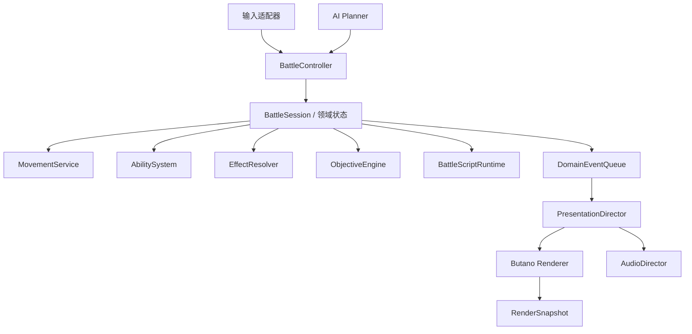
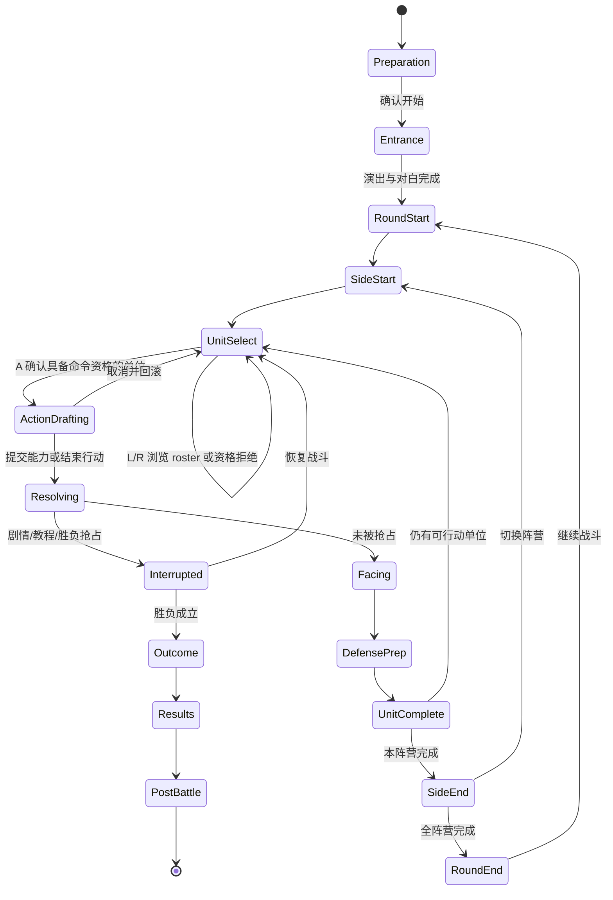

# Butano《木叶战记》战斗系统架构设计

日期：2026-07-22（2026-07-27 更新）
状态：**旧截图实现已被用户否决；证据驱动的通用领域运行时已落地并通过多单位/召唤/护送、角色技能持久状态、统一主/副技能修炼、SRAM 战役存档、campaign 三人队伍、九格装备/章节持有量的手工分配与战斗消费回写、章节忍具/素材数量与实时战前强化入口和 Arena 双方至多三人阵容到动态部署的接线、编队 15/24/9 运行时配置和 14 类直接被动玩法，47 场逻辑地图、原始碰撞和 ROM 视觉背景已进入统一内容目录；scenario 41 已由任务规则驱动共享 controller 完成四回合、150 经验、升级、修炼和存档；战斗退出已改为胜利/失败/平局/撤退结果协议，SELECT 隐藏跳关已删除，campaign 只在胜利事务中提交；生产入口已用原 ROM 证据表替换 41→43→9→11→32 夹具链，并签发 scenario 41 胜利保存后冷启动进入 scenario/battle 42。当前只覆盖 scenario 41–50 的九段 battle-only 路由，scenario 48 剧情和后续章节仍未实现。表现层已从“地图/双人”二分修正为包含单角色自身忍术事务。音频语义骨架和 S3M BGM 可用，但导入 WAV SFX 因 Maxmod mixer 冻结已暂时禁用；商店/掉落/补给、Arena 选择/解锁/结算入口、Link 通信、对象专属表现、完整剧情 orchestrator、逐技能表现与逐技能专属 cue 仍未完成，不得以现有样本宣称全游戏功能等价**

2026-07-27 最新里程碑：scenario 46 已在真实 16×32 地图完成五次捕获并保存进入 47；
scenario 47 又在真实 13×21 地图完成 Team 7 对五敌、休息（宿主路线）、影分身、
五次击倒、三人结算、成长、SRAM 和 47→49。两关都只使用共享 controller、resolver、
AI、condition、progression 与 campaign 事务；自动化不写内存。场景 47 对话退出冻结
已证明是表现资源 cohort 延迟回收导致的 OBJ tiles 分配断言，并以显式资源生命周期边界
修复，不是增加第二次 A 或跳过演出。证据见
`notes/butano-battle-scenario-47-runtime-20260727.md`。scenario 49+、scenario 48
剧情和逐动作音画仍未闭合，Goal 保持 active。

## 0. 纠错声明与实施门槛

2026-07-23 的复核确认：此前 Butano scenario 41 把原 ROM 截图、固定选项和单条黄金路线拼接成可运行演示，并没有建立能生成这些画面与结果的完整战斗规则。该原型不再是迁移基线，也不算本设计的部分实现。它只保留为画面、音频和输入时序对照；交互战斗不得显示预制整屏截图或按固定路线伪造领域结果。

2026-07-26 的生产树复审把这条声明升级为自动门禁：活动 runtime 唯一可直引的 regular BG
是 ROM 组件重建的 `battle_duel_forest`，47 场地图必须经生成目录选择；graphics 目录只
允许 scenario 41 光标及阴影，不允许任何 scenario prebattle/attack/result/confirmation
整屏资产重新进入。门禁与审计边界见
`notes/butano-interactive-battle-asset-audit-20260726.md`。该门禁证明当前活动战斗没有
截图加载路径，但不替代逐技能组件、章节入口和逐技能专属音频验收。

## 领域实现状态（2026-07-25）

当前首个实现闭环已经替换旧固定伤害路径，但仍只是本设计的领域基础：

- `generate_butano_battle_action_content.py` 把 ROM 绑定的 87+94 条主动动作/忍具生成到
  `ActionDefinition` 固定表，成本、表现、效果、目标、范围和升级保持正交；
- `generate_butano_battle_unit_content.py` 把 63×(15+24) 个角色主动/被动槽及基础数值生成到
  `UnitDefinition`，scenario 41 从角色 1/30 实例化，不再手填 80 伤害或敌方 HP；
- 玩家与 AI 共用 `battle_action_resolver` 的资格、预览、逐 hit、成本和原子提交；scenario 41
  的敌方已从角色 30 的六动作列表逐项预览，并基于可达格选择合法最优动作真实伤害玩家；
- 每单位状态改为固定 16 个活动槽与 16 个 removed-event 槽，已实现低 6 位查找、替换、移除、
  side-end tick 和写轮眼首有效 hit 截断。
- 活动战斗阶段已停止加载整屏 combat layer，改为无单位地图、独立单位/游标 sprite 和领域快照
  生成的 HP/菜单；2580 帧 mGBA 路线证明移动、选术、选目标、伤害、退场和战后可连续运行。

截至 2026-07-24，七维 AI utility、多目标范围事务、全部非空主动/忍具 effect code 的
数值稳定处理器、单/变体/成对召唤、多单位双方调度、47×3 有序 condition、32 槽战场对象
和护送角色死亡判定已经接入。不可交互的教程/结算参考帧暂留在表现层且不再拥有领域写权限；
47 场地图部署、脚本触发和失败/特殊结算表现仍不计入已完成范围。

截至 2026-07-25，敌方行动已纠正为“主指令 + 第二指令”两段领域事务。原 ROM
`0x080851F8` 的规划工作区分别在 `0x0202D228+0x10` 与 `+0x24` 保存两个 20 字节候选；
敌方主行动经 `0x8000` 后由 `0xC000` 复制第二候选并进入 `0xD000`，不会打开玩家防御 UI。
Butano 因此不再用固定 `no_ability` 结束敌方回合，而是在主行动/condition 之后构建同一个
内容驱动防御目录，规划并原子提交第二指令。

替身术也已从旧 `bool substitution_ready` 占位升级为 action 3 防御事务：动作表效果
`0x04` 在防御准备边界映射为原 ROM 运行时反应 `0x16`；首个有效 hit 消费一次反应、截断
本次多段攻击、保持 HP，并在会话保存的战场拓扑中选择曼哈顿距离 1–2 的可通行未占用格。
`ActionResult` 与 `reaction_resolution_event` 同时携带位移起终点，表现层无权改坐标。
29 个 battle 15 绑定样本支持这些结果语义；精确落点 RNG 权重与多个反应同时存在时的完整
优先级仍待闭合，不能把当前中性候选策略宣称为原 ROM 公式。

截至 2026-07-25，生产树中早期原型遗留的第二套 `ability_resolver`、
`apply_effect_chain`、`unit_state` 和 `substitution_ready` 已删除。它们曾使用固定伤害、
单布尔替身和独立 HP/状态副本，即使主场景没有调用，也会给后续关卡提供一条绕开内容表与
正式 resolver 的错误入口。随机数生成器已独立为不含业务规则的 `battle_random.h`；
AI、玩家、benchmark、自检和场景只能通过 `ActionDefinition + BattleSession +
battle_action_resolver` 预览或提交。架构门禁扫描整个生产 include/src，禁止旧符号重新进入。

截至 2026-07-25，45 条被动成长记录和每个角色固定 24 槽被动状态已进入同一
`BattleUnitInstance`。ROM 已闭合的 type `0x0C` 会心与 type `0x19` 无视防御进入逐 hit
resolver；type `0x14` 进入公共恢复量公式
`floor(max_hp / 5) + value_a`；type `0x15` 进入结果域，只对同角色全部战斗实例携带经验之和
应用 `floor(exp * value_a / 100)`。四个消费者都从角色的同一 `BattlePassiveState`
查询，场景、AI 和表现层不得复制公式。全 ROM 直接调用库存证明查询函数只有 15 个调用点，
覆盖 `0x0C、0x14–0x20`；`0x01–0x0B、0x0D–0x13` 没有直接消费者，不能凭名称或成长值
臆造战斗效果。其余调用组的控制流、训练 UI 和显示名仍未闭合。battle 9 的状态驱动路线已
由同一个 controller 完成鸣人瞬移、樱召唤、佐助技能浏览、五敌 AI 和第 2 回合，不能再用
菜单截图替代领域结果。

截至 2026-07-26，角色等级不再直接决定技能是否进入战斗。ROM
`0x0806D4A0/0x080899EC/0x08093070/0x0806FDF2/0x0806D85C` 已把四字节槽状态闭合为
`0xFF 锁定 → 0 已解锁未习得 → 1..3 已习得等级`。角色 progression 持久保存 15 个
主技能和 24 个副技能状态；升级只做 `0xFF→0`，修炼命令每次扣一点并提升一级，catalog
只接受 `1..254`。动作等级在 browser/resolver 前按 ROM 成长类型物化，因此同一动作的
等级确实改变 potency、段数、成功率、距离、范围或持续时间，而不是只显示不同文字。
这条链使此前永久不可达的 20 个初始状态 0 动作获得正式修炼入口。完整证据、运行边界和
ARM 栈/显存回归见 `notes/battle-action-progression-20260726.md`。

同日又闭合了不能由等级解释的动作 19“狮子连弹”。原 ROM 的技能同步函数只在
battle 31 / variant 0、角色 2、动作 19 时把 `0xFF` 改为 `0`；Arena variant 1、
其他 battle 和其他角色均不匹配。架构上这不是 scene 菜单特例：
`battle_scene_controller` 先对持久 progression 执行普通等级同步，再执行可枚举的
scenario unlock rule，随后由同一个 loader 投影到战斗单位。解锁仍不等于习得，必须继续
经过统一训练事务 `0→1 / TP-1`。ROM 范围、调用点、字面量与失败关闭哈希见
`notes/battle-scenario-action-unlock-20260726.md`；剧情画面与音频时序仍未闭合。

截至 2026-07-26，角色等级也已从“标签与技能解锁输入”接入实际战斗属性。scenario loader
把 progression 或章节 policy 的等级与 63×`0x10` ROM 成长表合成 HP、查克拉、攻、防、
敏、移动和忍具容量，同时写入当前值与状态 reducer 的 `base_*` 等级基线。玩家、敌方、
脚本角色和部署 placeholder 共用这一入口；场景、AI 与关卡不再按角色 ID 复制成长公式。
此前 LV9 显示仍按 LV1 HP/伤害运行的假等级问题已由 battle 15 玩家、battle 10 敌方与
battle 41 progression 三条集成样本修复。证据见
`notes/battle-level-stat-runtime-20260726.md`。

截至 2026-07-26，完整 `0xB8` 编队记录不再只提供坐标。构造器
`0x0806ACAC..0x0806ADC4` 已把 `+0x0F` 等级、`+0x10` 的 15 个主动作槽、
`+0x4C` 的 24 个副槽和 `+0xAC` 的 9 个忍具闭合到同一单位实例。玩家持久 progression
优先；章节显式 policy 次之；固定敌方/脚本配置使用编队内嵌值；普通玩家记录继续使用队伍
模板；部署 placeholder 不拥有角色配置。battle 10 variant 0 的敌方鸣人也由原始
`+0x0F=0x14` 纠正为 LV20，并从编队得到动作 `1/2/5`、三个被动和五个忍具。
player/defense/AI 共用的目录容量因此为 15+9=24，不再截断第 9 个忍具。证据见
`notes/battle-formation-runtime-config-20260726.md`。

47 张 ROM 战斗背景已生成成 49 个 Butano regular-BG 分块，并由 battle ID 查询的唯一
`battle_background_content` 目录提供给通用 renderer。场景 wrapper 不再保存图片头文件、
像素尺寸或分块 origin；逻辑 scenario/map/conditions 与视觉 background 分别查询后必须
通过 battle ID 和格数到像素尺寸的交叉校验。该目录完成视觉内容寻址，不等于 47 场均已有
 章节入口、可选队伍、对象脚本或专属演出。

可见运行时入口已公开 `battle_runtime_scene_request`，章节层可显式提供
`battle_scenario_load_policy`。固定编队和 `deployment_required` 变体均使用同一部署预览、
controller 和回合链；空变体仍失败关闭。运行时不得自行给 `0xFA..0xFF` 填默认角色，正式
章节必须从真实队伍/章节状态构造 request。battle 32 的六 placeholder 路线只是注入契约
夹具，不是原作章节编队断言。

截至 2026-07-26，campaign party 的前三个角色会在场景创建前原子填入尚未解析的
`0xFF/0xFE/0xFD`，campaign 九格装备也以角色级 override 同时进入部署预览和最终 loader。
章节显式 placeholder/装备配置继续优先；无效 party 不修改候选 policy。33 个三席动态变体
因此获得正式队伍来源。battle 41 的 campaign 入口也不再硬编码忍具，默认 67/11/37 属于
新档案角色记录。
完整链和边界见 `notes/battle-campaign-scene-policy-runtime-20260726.md`。

同日对原 ROM `0xB8` 编队表和竞技场攻略流程的交叉验证，已将 battle 31 variant 1 与
battle 32–38 的 `0xFA..0xFF` 六席闭合为玩家队/对手队各至多三人，而不是 campaign 后三席
NPC。`battle_arena_match_roster` 为双方分别持有 progression 和九格装备；arena policy
原子启用/禁用六个 selector，同一角色可在双方以不同等级、技能状态和装备独立存在。部署
预览、loader、controller、AI、resolver 和回合流仍共用正式战斗域，Arena 没有第二套战斗
规则。battle 32 静音 mGBA 已以阵容 `[1,2,3]/[12,35,1]` 跑过完整第一回合、AI action 3
替身第二指令并进入 round 2。模式层必须持有 roster 到 session load 完成，Arena 与
campaign policy 不能同时注入。完整证据见
`notes/battle-arena-roster-runtime-20260726.md`；Arena 的选择 UI、解锁、结算入口与 Link
通信仍未实现。

同日又把“效果码存在”与“逐定义玩法正确”分开验收。33 个属性状态生产者（6 个主动动作、
27 个忍具）现在逐项从生成内容经过正式 preview/resolve 写入 `BattleSession`，验证状态
code、potency、duration、目标属性、忍具槽消费、精确到期与 `0x26` 四状态原子顺序。
万能丸提高最大 HP 时同步补入的当前 HP，在状态到期后只按新上限钳制而不对称扣回；这是
ROM side-end/reducer 顺序，不得被改成通用 buff 回滚。全量 84 个宿主程序通过，生产代码
无需修改。证据见 `notes/battle-status-action-compliance-20260726.md`。

### 战场对象领域链（2026-07-26）

对象表不再只是 condition 的占位记录。原 ROM `0x02026604` 的 32×16 字节表、
effect `0x0C/0x18` 创建器和阵营结束遍历 `0x08081B70` 已闭合到同一
`BattleSession`：

- slot 0 保留；`+0/+1/+2` 为 type/x/y，`+4` 为 payload/action ID，
  `+6` 为 16 位编码持续时间，type 1 的 `+8` 为 source unit；
- type 1/2 都只在阵营结束边界递减；type 2 到期先产生 actorless 位置表现事件、
  播放 sequence 7 后释放，type 1 到期按忍具模板、
  source 和方形范围进入正式 resolver 后释放；对象解析完成后才翻转阵营/回合并触发
  新阵营 side-start 被动，保持 `0x08081B70` 位于原 ROM 阵营翻转前的顺序；
- 对象伤害复用普通动作的命中、反应、被动和 linked resolution，不维护第二套公式；
- condition 在对象解析后求值，controller 和 renderer 只消费 session 事件与对象快照。

跨层返回使用 16 字节结算摘要，完整逐 hit 数据留在权威 session 事件中。该约束把 ARM
`battle_scene_control_result` 从 1464 字节降为 200 字节、场景栈帧从 9940 字节降为
3636 字节，避免 AI 边界调用覆盖场景状态。最终静音 ROM 路线在 round 2 观测到 slot 1
释放和 23 点真实伤害，并等待对象事件实际进入 active presentation 后才签发，证据见
`notes/battlefield-object-runtime-20260726.md`。type 2 的 sequence 7 已从原 ROM
resource group `0x12` 提取为 7 帧 32×32 精灵；controller、表现 FIFO 和 renderer
消费同一领域事件。存活对象只写地图格元数据，renderer 不得为其绘制游标或截图标记。
原版逐帧 hold 时长、音效和 type 1 起爆符专属动画仍未闭合，不能宣称全部对象表现已
功能等价。

### 战斗单位视觉内容层（2026-07-25）

ROM `0x596D5C` 已由旧“312 行地图 tile”解释纠正为 62 个角色 × 9 个视觉槽：
固定 558 行中有 342 个有效槽、216 个空槽，行映射是
`(character_id - 1) × 9 + visual_slot`。每个角色的槽 0 均提供帧描述表、动画描述表、
4bpp OBJ tile 和 BGR555 palette；首帧描述同时给出相对单位锚点的 X/Y、宽高和比例。

通用 renderer 必须用 snapshot/deployment 中的 `character_id` 查询
`generated_battle_unit_visual_content.h`，不得再按玩家/敌方阵营选鸣人或通用敌人。
尺寸和中心偏移同样来自 ROM 描述符：角色 42/59 的待机图为 64×64，角色 39/40/55
为 32×32，其余也存在不同 Y 锚点，不能使用单一垂直偏移。

12 个领域单位槽与表现对象是一一对应但非一律分配：`inactive` 槽保存为空的
optional sprite，不加载 tile/palette；召唤激活后在该槽创建，死亡或移除后释放；身份覆盖
改变 `character_id` 时对已有 sprite 调用 `set_item()`。这样表现生命周期跟随领域状态，
但仍无权修改坐标、HP、回合或召唤关系。ID 超出 1..62 的活动单位是内容错误，必须失败
关闭而不是显示替代人物。

### 领域数据流（2026-07-24 实现）

```text
ScenarioDefinition
  ├─ UnitDefinition / ActionDefinition / ConditionVariant
  └─ map + scripted control metadata
                │
                ▼
BattleSession ──┬─ unit roster + action ledgers + round boundary
                ├─ status / identity / summon link graph
                ├─ battlefield topology + objects + resolved counters
                │
       ┌────────┼──────────┐
       ▼        ▼          ▼
Movement    Action      AI planner
query       resolver    (shared preview)
       └────────┬──────────┘
                ▼
     atomic ActionResult + EffectsResolved
                │
                ▼
      BattleTurnFlow / condition interrupt
                │
        ┌───────┴────────┐
        ▼                ▼
     Outcome       Facing → Secondary command → Complete
                              │
                    player: defense selection UI
                    AI: utility plan without player UI
                │
                ▼
 presentation reads snapshot/events only
```

关键约束是：渲染层没有 HP、查克拉、坐标、召唤槽、回合或胜负的写入口；AI 与玩家共享同一
预览/提交；范围动作只扣一次成本；condition 直接读取提交后的会话快照。

### 战斗结果与战役事务边界（2026-07-27）

单场控制器是结果唯一事实源。可见场景只允许在 `battle_scene_phase::complete` 时把
snapshot 的 `win/loss/equal_slot_result` 映射为 `victory/defeat/draw`；START 是
`aborted`，SELECT 不属于战斗路由输入。表现、按键或章节 wrapper 不得自行生成胜利。

`run_battle_scene` 以该结果作为 campaign 事务边界：目前只允许 victory merge 角色成长、
训练和忍具消费；defeat/draw/aborted 均回滚场内候选。章节层只能消费
`battle_runtime_exit_advances_campaign` 决定是否进入后继，不能再比较 fixture
`next_battle` 或忽略返回值。运行时负证据已证明 SELECT 前后保持 battle 41、round 1、
unit-selection；完整证据见
`notes/butano-battle-result-routing-runtime-20260727.md`。生产入口现由
`battle_campaign_route` 消费 scenario ID，并按原 ROM checkpoint 限定为
`41/41 → 42/42 → 43/43 → 44/44 → 45/45 → 46/9 → 47/13 → 49/14 → 50/15`。
scenario 48 是尚未实现的纯剧情段，56 是当前切片的终止哨兵。scenario 41 胜利保存为
42、冷启动加载 generation 1 并进入 battle 42 部署的运行证据见
`notes/butano-battle-campaign-route-runtime-20260727.md`；这仍不能代替完整剧情
orchestrator。

本设计必须在以下证据门槛全部通过并经用户重新审阅后，才能进入 Butano 重写：

1. 63 条单位模板及其角色/敌人/变体身份、成长和可用动作槽完成可追溯建模；
2. 87 条角色主动动作及其同 ID 数值模板、45 条被动/训练效果和 94 条忍具动作被正确分库，名称、成本、目标、数值、升级与效果关联不再靠猜测；
3. 单位选择、移动、施术、补充查克拉、休息、待机、面向、防御准备、敌方阶段、打断、胜负与结算的完整回合状态转换由多场原 ROM 运行证据闭合；
4. 单人、多角色、召唤、多敌 AI、护送/捕获/占位等复合目标至少各有一个可重放的原 ROM 验收样本；
5. 领域模型能仅凭关卡与内容数据产生合法行动和结果，渲染层没有写入 HP、坐标、资源、回合或胜负的通道。

## 1. 目标

在 Butano 21.7.1 上建立可承载《木叶战记》全部战斗关卡的通用领域架构。设计以在线录屏逐帧分析和 scenario 41–50 原 ROM 运行证据为输入，纠正当前 `scenario_41_battle` 的单场景硬编码模型。

本设计要求：

- 保留原作“准备 → 入口演出 → 玩家阶段 → 敌方阶段 → 胜负/结算”的可见流程；
- 支持多单位、召唤单位、移动、术/忍具、查克拉、休息、行动结束、面向和防御准备；
- 支持可组合胜负目标、剧情打断、护送/占点/捕获等非清敌任务；
- 领域逻辑与 Butano BG/OBJ、输入、音频和逐帧演出解耦；
- 在 GBA 固定内存预算下使用固定容量数据结构，避免运行时堆分配；
- 同一领域核心可被宿主 C++ 测试、Butano 场景和 mGBA 黄金路线共同驱动。

本文不把尚未逆向的数值写成猜测常量，但角色、动作、被动、忍具、AI 与关卡数据的**完整字段模型、引用关系和证据等级**是设计验收范围，不能再推迟到实现后补齐。设计不要求照搬原 ROM 的 WRAM 地址或 Thumb 控制流，但每项用户可见规则必须能回链到 ROM、运行时录像/快照或相互印证的攻略证据。

## 2. 证据优先级

1. 原 ROM 的受控输入、checkpoint、内存字段和逐帧 trace；
2. 原版日文录屏的可见顺序；
3. 中文补丁录屏的控制流程；
4. 文字攻略对菜单语义的补充；
5. 当前 Butano 实现仅作为反例和可复用局部资产，不作为规则权威。

逐帧证据、来源哈希和观察窗口见 `notes/butano-battle-video-frame-analysis-20260722.md`。

## 3. 方案比较

### 方案 A：继续扩展单体有限状态机

把更多 `battle_phase`、关卡条件和技能分支继续加入 `scenario_41_battle`。优点是短期改动少；缺点是回合、单位行动、演出、输入和关卡脚本继续耦合，每增加技能或目标都会扩大 switch，无法可靠处理剧情抢占、取消回滚和多单位行动。此方案不采用。

### 方案 B：分层状态机 + 事务式行动 + 数据驱动规则（采用）

根状态机只管理战斗生命周期和阵营阶段；单位行动使用独立子状态机；技能、效果、目标和胜负条件由数据驱动；所有可见演出进入阻塞式演出队列。它既能表达原作流程，又能用固定数组和显式命令适应 GBA，测试边界清晰。

### 方案 C：完整 ECS + 事件溯源

单位、效果、动画全部建成 entity/component/system，并保存完整事件日志。扩展性最高，但会带来运行时索引、内存、调试和序列化成本；原作单位规模和规则复杂度不需要完整 ECS。设计仅采用轻量实体 ID 和领域事件，不采用完整 ECS/事件溯源。

## 4. 总体分层



依赖方向固定为“适配器 → 领域 → 事件 → 表现”。渲染器、音频和 Lua/mGBA 验收不得直接修改领域状态。

## 5. 核心运行时模型

### 5.1 BattleScenarioDefinition

只读关卡定义，构建期生成：

- 地图、地形、阻挡和初始相机；
- 参战单位、阵营、部署规则和可控性；
- 胜利/失败目标表达式及优先级；
- 教程限制、剧情触发器、入口/战中/战后脚本；
- BGM、场景资源和关卡专用规则参数。

关卡差异进入定义或小型规则插件，不复制战斗控制器。

截至 2026-07-24，`BattleScenarioDefinition` 的地图尺寸、地图标记和初始编队已从
`sequel/content/maps/bank.json` 与 `sequel/content/positions/bank.json` 生成。内容边界是
47 场 × 3 variant × 12 槽；编队记录地址公式为
`0x5461C4 + battle_id×0x1AAC + variant×0x08E4 + 4 + record×0xB8`。固定角色选择器
直接引用 63 条 `UnitDefinition`，`0xFA..0xFF` 保留为部署占位符，并且必须由进入关卡时的
策略显式绑定，不能猜成角色 ID。加载器先在临时 `BattleSession` 中验证容量、角色、控制权和
占位符，再原子替换目标会话，失败时不得留下半套编队。

`BattleScenarioUnitRuntimeConfig` 同时保存编队记录里的 level、unit parameter、
15 个主动作四字节槽、24 个副动作四字节槽和 9 个忍具 ID。它不是玩家持久角色表的副本：
loader 必须按“progression → 显式章节 policy → 编队拥有配置 → 角色模板”选择唯一来源。
显式忍具覆盖使用独立布尔门，因此全零数组可以表达“本关清空装备”，不能再用“是否存在
非零 ID”猜测调用方意图。

原 ROM 的单位扫描固定遍历 1–12 号槽，因此需要召唤的关卡不能把未部署记录从 session
物理删除。loader 在关卡策略明确要求时保留固定 12 个单位槽：有效记录实例化正常单位，
空记录实例化为稳定 UnitId 的 inactive reserve。reserve 没有命令资格、不会被目标或
胜负扫描当成有效单位，但可由召唤 resolver 在提交时原子替换为召唤者派生实例。容量不足
必须在临时 session 中失败，不能装载四个单位后再临时追加无身份的 UI 角色。

部署是 `BattleSession` 创建前的独立领域阶段，不是玩家回合的截图。`battle_deployment_flow`
复用场景加载器的 selector 解析，依次输出每条活动编队记录的角色、阵营、格点和面向；
每次 A 只确认当前记录，全部确认后进入独立的 START confirmation，再由同一 load policy
创建 controller。B 可退回上一条，首条 B 取消部署。最终 A 必须完全释放并经过一个中性帧，
才能启动玩家控制器，防止“确认开始”的按键边沿同时确认首个角色。固定编队也必须经过这条
可见流程；`0xFA..0xFF` 动态编队只有在章节/队伍层显式提供六槽绑定后才能进入。

地图/编队、剧情入口和 condition 表是三个独立索引域；例如当前可见 scenario 41 使用
编队 41，而已验证目标条件来自 condition battle 9 variant 0。场景、编队与条件 ID 不得假定恒等，
只能由章节/关卡定义显式组合。生成 47 场地图与编队只闭合了部署数据，不代表入口脚本、
对象实例、剧情打断和结果表现已经接入，也不代表 47 场已经可游玩。

### 5.2 BattleSession

唯一可变领域聚合，包含：

- `round_index`、当前 `side_phase` 和生命周期状态；
- 固定容量 `UnitInstance` 集合和占位索引；
- 当前 `UnitActionState` 与可选 `ActionDraft`；
- 查克拉、忍具库存、状态效果、召唤关系和 RNG 状态；
- 目标进度、剧情变量、结果与奖励草案；
- 固定容量领域事件队列。

`BattleSession` 不包含 BG、sprite、文本对象、音频 handle 或按键状态。

### 5.3 UnitInstance 与行动账本

每个单位至少保存：

- 稳定 `UnitId`、角色模板 ID、阵营、控制方式；
- 当前格、面向、HP、查克拉、状态、库存引用；
- 本回合 `ActionLedger`：是否可行动、是否移动、是否使用主动能力、是否结束、已准备的防御；
- 召唤者、生命周期和 AI 标签；
- 动画/外观只保存逻辑姿态枚举，不保存 Butano 对象。

影分身是正常 `UnitInstance`，通过召唤关系和受限能力集表达，不用特殊全局变量。

## 6. 分层状态机（候选模型与 ROM 锚点）

下图是待验证的领域归一化模型，不是对原 ROM 控制流已经完成的命名。原 ROM
`0x080732B4` 已静态闭合 36 个分派值；当前只允许把有地址和运行时证据的锚点映射到
领域阶段：`0x1300` 阵营/资格扫描、`0x2000` 玩家单位选择、`0x1020` 当前单位激活、
`0x3000` 初始行动菜单、`0x3110` 移动选择、`0x4000` 移动后行动菜单、
`0x4100` 施术目标/确认、`0x3210` 查克拉交换结果、`0x3310` 休息确认、
`0x6000` 玩家提交门、`0x7000` 敌方行动准备、
`0x9000` 面向、`0x9100` 防御准备、`0x9200` 术菜单、
`0xD000` 行动完成、`0xE010` 胜负/退出检查、`0xF000..0xF400` 结果与 postbattle。
`0x8000` 已确认同时承载战斗对白、结果弹窗和胜利演出，说明可见子流程不等于顶层状态。
其余原 ROM 状态保持 unresolved，不能因为下图存在就推断其语义。完整机器清单见
`notes/battle-controller-states-20260723.json`，18 个可见/行动边界与任务栈绑定见
`notes/battle-controller-checkpoint-bindings-20260723.json`。

单位选择层必须把 roster 游标与已确认行动单位分离。四次连续 L 输入的运行时绑定证明，
`0x2000` 内本场 L 的完整环绕顺序为鸣人 → 猫 → 小樱 → 佐助 → 鸣人；每次只转移两个实例的
`unit+0xC1` 选择标记，当前行动单位指针仍为空，战斗控制区也不提交变化。只有确认单位后
才创建 `ActionDraft` 并绑定 actor。目标代理也可以进入可选 roster：猫实例虽没有主动动作
模板，仍可成为游标目标，因此“是否出现在 roster”“是否可行动”“可用哪些命令”必须是三次
独立查询，不能用角色类型或非空技能表替代。空槽可能保留陈旧标记，任何扫描都必须先验证
实例有效性。新增 R 样本又从鸣人切到佐助，仍只转移同一选择标记且不绑定 actor，因此
L/R 的方向均已有运行时绑定，本场完整环绕也已闭合。

进一步的 battle 15 对照证明必须把浏览 roster 与命令资格分离。已行动单位仍能被 L/R 浏览，
护送/任务代理同样能成为选择目标；资格检查发生在 A 确认边界。可行动小樱的 A 把
`0x2000` 推进到 `0x3000` 并绑定 actor，而已行动佐助与护送目标的 A 都是保持 `0x2000`
的领域 no-op，单位池、战斗控制区和菜单状态块均无变化。因此 `UnitSelect` 保存的是可浏览
roster，`can_issue_commands(unit)` 才决定确认能否创建 `ActionDraft`。死亡、失能、召唤物及
跨关卡资格差异仍是实施前缺口。



`Entrance` 和 `Interrupted` 不是黑屏占位状态，而是由演出队列驱动的可见序列。目标系统可在效果结算后立即进入 `Outcome`，因此捕获最后一只猫时可以跳过面向和防御；需要“指定位置+指定面向结束行动”的目标则在 `UnitComplete` 事件后成立。

当前能从 ROM 确认的调度骨架是：阵营扫描会遍历固定 12 个战斗单位槽，依据阵营、
有效状态和单位行动字段决定进入玩家选择还是另一行动方；玩家选择随后绑定当前单位，
再进入初始行动菜单。scenario 41 的哈希绑定 checkpoint 已进一步证明：可达格移动位于
`0x3110`；移动后命令集切到 `0x4000`；术菜单位于 `0x9200`；目标选择和攻击确认共享
`0x4100` 的嵌套子控制器；行动后的面向与防御分别位于 `0x9000/0x9100`。行动尾部通过
MOVEDONE 边界进入阵营/胜负后续链。四组哈希绑定的跨关卡事务证据进一步确认：三个
取消样本均不改变单位池、忍具库存或战斗控制区；一个瞬身术提交样本只在
`0x8000 → 0x9000` 时同时写入查克拉、落点和行动标记。机读证据见
`notes/battle-action-transaction-bindings-20260723.json`。AI、其他成本类型及这些顶层
状态内部的完整转移仍在追踪，因此本节仍不能作为 Butano 实施许可。

## 7. 事务式单位行动

### 7.1 ActionDraft

玩家或 AI 选择单位后创建草案：

- 起点、预览位置和路径；
- 已选择命令、能力、目标格/目标单位；
- 预计资源成本、命中、伤害和效果摘要；
- 当前可取消层级；
- 提交后将产生的领域命令。

移动预览、技能目标和确认期间只修改草案。B 返回上一层；回到单位选择时完整丢弃草案。只有攻击/能力开始解析或确认“行动结束”时，移动、资源和效果才原子提交。

该边界不是从 UI 猜测：取消样本已证明三种返回层级只改变 modal/控制器子状态；提交样本
证明 `unit+0x07` 当前查克拉、`unit+0xC4/+0xC5` 坐标和 `unit+0xC0` 行动标记在
解析完成后一起改变。新领域模型可以采用不同内存布局，但必须保持相同的可观察事务语义。

### 7.2 命令资格查询

`CommandEligibilityService` 根据单位、账本、资源、地形和关卡限制返回：

- `available`：可选；
- `disabled(reason)`：显示但拒绝；
- `hidden(reason)`：本状态不显示。

完整命令集合是移动、术/忍具、补充查克拉、休息、行动结束。移动或施术后菜单自然缩减，不在 UI 中写死场景特例。

主动术与忍具列表由 `battle_action_catalog` 统一生成：它读取角色实例持久化的 15 个
主动槽状态和 9 个本场忍具槽，保留技能等级、主动术/忍具来源及具体 tool slot。角色等级
只参与把锁定槽同步成“可修炼”，不能直接生成可战斗技能。catalog 只接受状态 `1..254`，
并在进攻/防御 browser 校验前物化等级成长；两种 browser 不得各自重建角色技能列表，
也不得让 scenario facade 或 renderer 复制角色等级、修炼与装备规则。

主动技与忍具是两个独立 ID 空间，动作身份不得表示成裸整数。所有 browser、AI candidate、
preview、resolver、资格与表现投影至少以 `(source_kind, id)` 为键；忍具还必须携带
具体装备槽。特别是主动技 43–49 的八门状态资格只能应用于 `active_action`，不能因为
忍具具有相同数值 ID 而套用。该规则由 tool 49 正式路线暴露并固定，证据见
`notes/battle-opponent-bomb-tool-presentation-evidence-20260727.md`。

战后主技能修炼同样不能另造规则。controller 在等级结算后进入独立 `training` phase；
`battle_primary_training_flow` 只维护角色/技能选择，完整非空主槽目录、锁定/未习得/等级
状态都从 `character_progression_record` 与 `unit_definitions` 重建。A 键唯一调用
`train_primary_action`，B 结束分配，renderer 只读紧凑快照。训练目录不进入每帧
`battle_scene_snapshot`，以保持 1,120 字节预算。实机 action 8 `0→1 / TP 1→0` 见
`notes/battle-primary-training-runtime-20260726.md`；SRAM 和副技能修炼仍是独立边界。

目标确认统一进入 `battle_action_execution`。该服务根据 target policy 查找目标单位或
空地，根据 effect handler 选择单体/范围 resolver，并为单体、变体或成对召唤选择第一个
合法 inactive reserve。preview 零写；resolve 仍由共享 resolver 在 session 副本上扣成本、
建立召唤关系、应用效果并进入 `EffectsResolved`。scenario 43 的固定 12 个单位槽包含
4 个部署单位和 8 个 reserve，已作为影分身跨关卡测试输入；这条链不能由表现层注入
召唤 sprite 来伪造。

### 7.3 提交边界

- 选择目的格：仍可撤销；
- 打开能力列表/移动目标：仍可撤销；
- 最终“可以吗？”之前：仍可撤销；
- 能力成本扣除和效果队列建立：不可撤销；
- 行动结束确认：提交移动并进入尾部；
- 剧情/胜负抢占：清理草案，按脚本指定是否标记行动完成。

查克拉命令是 HP 与查克拉之间的领域事务，而不是 UI 直接改数值。已绑定样本在
`0x3000 → 0x3210` 一次提交 HP `134→119` 与查克拉 `4→5`，忍具库存不变。
休息会结束当前单位行动：已绑定样本在 `0x3310 → 0x1220` 提交 HP `24→41`、保持
查克拉不变，并把低位行动标记从 `0→32`。实现必须把两者建成领域命令并由同一事务层提交；
单一样本中的 15/17 仍不得硬编码为全局常量。

后续静态控制流与跨角色 checkpoint 联合绑定已把基础公式闭合到
`notes/battle-resource-command-rule-bindings-20260724.json`：

- 每补充 1 点查克拉，消耗 `unit+0x0A`（结印）点 HP；数量同时受 `unit+0x08` 查克拉上限
  和 HP 至少保留 1 点约束。数量调整只形成预览，确认前会回滚预览资源；
- 休息恢复 `floor(max_hp / 5)`，其中最大 HP 来自 `unit+0x0E`，并截断到缺失 HP。
  佐助 `89→17` 与鸣人 `152→30` 两个恢复量样本交叉验证该公式；
- 两条命令都必须保持预览无写入，并在确认时通过会话副本原子提交。休息随后完成单位行动；
  补充查克拉作为无目标资源行动进入同一单位完成/condition 求值链。

这些是无被动、无状态、无脚本改写单位的基础规则。被动修正、状态修正、关卡脚本覆盖及表现
时序继续作为独立策略，不得反向写进基础公式。

### 7.4 两阶段行动提交与可中断尾部

`battle_action_resolver` 的职责止于校验草案、原子扣除成本、应用移动与效果，并把会话推进到
`EffectsResolved`。**Resolver 永不完成单位行动**：成功返回时 actor 的
`ledger.acted=true`，但 `ledger.completed=false`，当前阵营和已绑定草案都保持不变。
渲染器也不得用动画结束事件替代这些领域状态转换。

`BattleTurnFlow` 在 `EffectsResolved` 边界立即运行 condition。若胜利、失败或结果 5 成立，
目标判定抢占普通行动尾部，直接进入 Outcome，保留尚未完成的 actor 作为中断现场；若目标未
成立，才依次执行 `FacingSelection`、`DefenseSelection` 和 `UnitComplete`。其中
`FacingSelection` 写入最终面向，`DefenseSelection` 写入本回合准备的防御动作，只有
`UnitComplete` 可以设置 `ledger.completed`、推进同阵营下一单位、切换阵营或进入下一回合。

玩家与 AI 必须调用相同的三段尾部 API。AI 可以按规划目标自动选择面向并准备
`no_ability`，但不得使用一个“立即结束行动”的旁路。condition 内容非法时，
`BattleTurnFlow` 在会话副本上失败并保持真实会话不变。

### 7.5 防御准备事务与反应子事件

当前 `battle_defense_preparation` 已把防御准备从账本占位升级为领域事务。它复用生成后的
`ActionDefinition`、动作资格、成本策略和 16 槽状态库，但在确认边界按 ROM effect code
与来源种类做双重绑定：`0x10 只接受主动术`，`0x19 只接受忍具`。进攻术、召唤术、伪造的
“忍具写轮眼”和尚未闭合的 reaction code 均返回明确的 unsupported category，不能按名称
或菜单位置放行。

`battle_defense_browser` 是上述事务的只读投影，不是一份 scenario 菜单副本。它从当前
`UnitInstance.character_id` 与角色实例等级读取角色定义的 15 个主动动作槽，再追加实例
装备的 9 个本场忍具槽；每个项目都调用 `battle_defense_preparation::preview`，因此
进攻术仍可浏览但会显示不可确认，只有预览成功的防御/回避动作才允许提交。等级由剧情或
部署策略显式提供；场景数据没有等级证据时回退到 1，不能从未知 positions 字节猜测。
场景 facade 只保存菜单游标和当前只读 snapshot，不复制学习等级、动作类别、成本、装备槽
或状态容量规则。

预览零写入；提交在 `BattleSession` 副本上依次复核资格、成本、忍具 ID/槽位和状态槽容量，
再原子扣除查克拉/HP 或消耗本场忍具槽、建立一次性状态令牌，并把主动术与忍具来源类型、
动作 ID 和忍具槽写入行动账本。任一步失败都保持 `DefenseSelection` 会话不变。明确选择
`no_ability` 仍走同一个回合尾完成入口，但不产生令牌或资源变化。

来袭解析把命中结果与反应消费放在共享 resolver 内。写轮眼跳过 miss，只在首个有效 hit
消费 `0x10`，替换该 hit 并截断后续 hit；第二次攻击不再受保护。火弹只在相邻有效 hit
消费 `0x19`，以防御者为 source、原攻击者为 target 反向调用同一伤害结算；非相邻时不触发且不消费。
解析结果使用 `reaction_resolution_event` 显式携带 reaction code、主动术/忍具种类、
规范化动作 ID、忍具槽、source/target、incoming hit、实际伤害与战败，不让表现层推断身份
或自行扣血。原有 encoded action ID 只作为 ROM 对照元数据保留。

该实现已闭合已有运行时证据的写轮眼 `0x10`、火弹 `0x19`，以及由动作效果 `0x04`
准备、以运行时状态 `0x16` 消费的替身反应。来袭前先由唯一只读仲裁器按原 ROM 静态绑定的
`0x04 → 0x0A → 0x09 → 0x10 → 0x16 → 0x19` 选择第一个存在的令牌，再进入对应
handler；同一次 hit 不遍历或叠加后续反应。原 ROM 单输入 A/B 与共享 resolver 反汇编已经
闭合三种此前未知的控制流：`0x04` 仅在相邻时消费并取消整次来袭，不移动；`0x09` 在
`status+3` 距离内反向伤害攻击者并取消来袭；`0x0A` 在同一距离门内先反向伤害攻击者，再
继续原来袭伤害。`0x16` 与 `0x19` 同样要求相邻。`0x09/0x0A/0x19` 共用一个 counter
handler；它只通过显式 `not_triggered / continue_incoming_damage / cancel_remaining_hits`
结果控制外层 hit 流程。替身没有合法落点时也不会继续尝试低优先反应，而是保留令牌并让
来袭正常结算。动态证据和状态哈希见
`notes/battle-reaction-family-runtime-20260725.{md,json}`。尚无原 ROM 自然多令牌共存
样本；`0x09` 的显示名称和各反应精确演出时序仍不得外推。

### 7.6 通用玩家行动 Flow

`battle_player_action_flow` 是输入适配器与 `BattleSession` 之间的应用层状态机。它只保存
动作/防御列表游标、modal phase、目标 preview、最近结果与 outcome，不保存 HP、查克拉、
单位坐标或回合副本。它按顺序组合动作目录、目标执行、`BattleTurnFlow`、朝向和防御事务，
使 action → target → effects → facing → defense → complete 不再由每个关卡 switch 重写。

关卡教程限制通过只读 action access policy 投影完整目录。例如 scenario 43 的测试策略只
显示 action 7，但角色目录仍保留 action 2、5、7；policy 不得改写学习等级、成本、target
policy 或 effect handler。目标 preview 直接读取真实 session 且零写；最终确认先在完整
session 副本中执行 resolver 与 condition 尾部，两者都成功后才替换真实 session，避免
“伤害已扣但关卡条件解释失败”的半提交。

scenario 41 的玩家侧选术、目标确认、结束行动、朝向和防御已经委托该 flow；scenario facade 不再
直接提交玩家侧 resolver，只把按键映射为 flow 方法并复制只读 snapshot 给 presenter。移动、
术/忍具、补充查克拉、休息和行动结束现在由同一个固定容量命令目录动态查询；移动路径预览、
资源数量预览和取消都保留在 `ActionDraft`/flow 中，scenario 不再直接写坐标或资源。敌方
AI 已由 11.1 节的通用单位回合 flow 接管；AI 防御与 AI 主动选择补充查克拉/休息的效用策略
仍未闭合。这些边界完成前不得宣称整个 BattleController 已统一。

空格动作的占用资格必须读取草案的“预览移动后”单位视图：行动者原位置在预览移动后视为空，
预览终点视为被行动者占用，其他活动单位保持其提交位置。目标身份查询对
`target_policy_kind::empty_tile` 固定返回空目标，不能从尚未提交移动的 session 反查到
行动者自己。否则 planner 可以合法选择“先移动、再以腾出的原格为位移动作目标”，执行器却
以 `occupied_target_tile` 拒绝同一候选，破坏 AI 与玩家共享预览/提交的事务契约。

忍具必须把持久装备/背包与战斗内可用槽位分层建模。已绑定的十字手里剑样本在
`0x4100 → 0x9000` 提交时，把行动单位首个装备槽 `unit+0xB1` 从 `1→0`，但持久忍具
库存区、HP 和查克拉均不变。`BattleSession` 因此从持久 loadout 初始化每个
`UnitInstance` 的本场可用忍具；行动提交只消耗实例槽位。Butano 的 scene progression
现在会按原角色 ID 导出九格最终值，并与成长记录原子合并回 campaign，再由 SRAM adapter
持久化。未部署队员保持原装备，召唤/分身不能覆盖档案。这个实现闭合的是九个已装备 ID 的
消费回写；原 ROM 证据仍只直接闭合首槽和一次消耗，不允许据此推测 `unit+0xB0`、背包数量、
堆叠格式或自动补充规则。运行证据见
`notes/battle-campaign-tool-writeback-runtime-20260726.md`。

### 7.7 有序两组件动作与连续攻击

原作的连续攻击不是表现层动画选项，而是 `ActionDraft` 内的有序两组件事务。原 ROM
`0x08075B58` 只在组件数为 2 时扫描 `0x0853DFB0` 的五条三字节配方；表指针字面量位于
`0x08075C0C`。精确配方依次为 `9+8→10`、`9+5→11`、`12+12→13`、
`16+16→17`、`16+忍具1..17→18`。命中配方后，两个输入组件被替换为一个派生动作；
未命中配方时，ROM 保留两个输入组件并分别调用主动术/忍具初始化器，形成两个动作事件。
静态哈希、工具高位编码 `0x81..0x91` 和 fallback 控制流由
`notes/battle-action-combination-bindings-20260725.json` 绑定。

玩家输入层必须显式保存以下阶段，不允许 scene 根据截图或动作名跳转：

1. `ActionSelection`：浏览当前角色真实已学术和本场忍具；
2. `CombinationDecision`（组合确认）：可单独攻击的联携术选择“是”继续选择第二组件，
   选择“否”按普通单动作进入目标阶段；
3. `ComponentStaged`：第一组件及资源预留只存在于 flow 草稿，真实 `BattleSession`
   零写；B 撤销后仍留在术列表；
4. 第二组件确认：只允许共享伤害目标的攻击术/攻击忍具；五条配方生成派生动作，其余合法
   配对生成有序双效果序列；
5. `TargetSelection → Resolve`：共同目标预览成功后，在 session 和 RNG 副本中复核两项
   资格、合计成本、忍具槽和状态容量，再原子替换真实会话。

多重影分身（动作 9、effect `0x08`）本身不能成为独立目标效果，所以跳过是/否分支并强制
暂存第一组件。普通未匹配的 `9+攻击术/攻击忍具` 把动作 9 的 potency 作为后续攻击的额外
hit 数，成本仍为两个组件之和；这与攻略“给 applied attack 增加额外攻击次数”及原版菜单
运行样本一致。火遁术等可单独使用的首组件先显示组合确认：选“否”保持单动作，选“是”
暂存成本后回到列表。派生动作 ID、动画族和目标类型必须由领域结果投影给表现层，不能继续
显示第二个菜单项冒充组合结果。

`battle_action_combinations` 只编排已有动作资格、成本、目标和 resolver，不实现第二套伤害
公式。特殊配方把合计成本提交一次并调用派生 descriptor；未命中配方按原顺序执行两个
无成本副本并合并 `ActionResult`，整个过程失败即回滚 session/RNG。动作范围的距离只取
`distance_and_line_flags` 低 5 位；`0x20/0x40/0x80` 是标志，不能被当成距离扩大到
36、67 等非法值。

原版菜单的多重影分身强制选择、火遁术资源不足门、火遁术组合确认和第一组件资源预留记录在
`notes/battle-action-combination-player-flow-20260725.md`。这些样本闭合玩家入口和已知
配方架构；尚未逐角色验证所有红圈术的提示文本、默认光标和专属演出时序，因此不得据此宣称
全部连续攻击表现完成。

ARM 接入必须把 `battle_scene_phase` 视为单一编号来源。新增
`CombinationDecision` 后，后续枚举值整体移动；mGBA 首次回归以遥测确认 ROM 正常停在
`script_blocked=18`，但 Lua 仍等待旧值 17。所有脚本常量修正后，新增
`test_butano_battle_phase_contract.py` 直接解析 C++ 枚举并校验每个 Lua 常量，避免场景
架构演进时自动化静默停摆。静音 scenario 41 的共享单动作 ARM 回归在 frame 464 到达
`complete=16`，控制器/玩家错误均为 0；它证明组合阶段接入未破坏部署、回合、动作、结果
和升级链，不代替两组件专属表现的后续实机验收。审计为
`artifacts/butano-action-combinations-s41-results-20260725-04/audit.json`。

## 8. 移动与地图

`MovementService` 负责：

- 32×16 逻辑格与地图 tile 的映射；
- 地形成本、阻挡、单位占位和临时占位；
- 可达范围、最短合法路径和目的格验证；
- 移动能力/瞬身等非普通路径；
- 为 AI 和玩家返回相同的查询结果。

占位更新只发生在行动提交。AI 规划可建立只读模拟占位，不能先改真实地图。地图服务不判断胜负；移动提交事件交给目标系统处理。

## 9. 能力、忍具与效果

### 9.1 AbilityDefinition

统一描述术、体术、忍具和特殊行动。ROM 证据已经否定“一个技能枚举同时决定成本、目标和
效果”的模型：运行时 `+0`、`+2`、`+3` 分别承载三种互不依赖的轴。因此核心必须拆成
`CostPolicy`、`EffectDescriptor`、`TargetPolicy` 三个正交策略，并另外组合
`RangeShape` 与 `UpgradeRule`：

- `CostPolicy`：none/current-chakra/current-HP/no-scalar-special/battle-local-tool-slot，并提供
  `can_pay`、`stage`、`commit`；取消和预览只能调用前两者；
- `EffectDescriptor`：稳定的低 6 位 effect code、flags 与参数，交给数据驱动 resolver registry；
- `TargetPolicy`：自己/隐式行动者、两种友军资格、敌军、任意占用单位、空格；资格查询不读取
  动画族或效果中文名；
- `RangeShape`：距离、直线 flags、范围/形状 flags 和视线规则；
- `UpgradeRule`：选择 potency/hit/success/distance/range/duration 中的一个成长目标，并在构建
  runtime descriptor 时应用；
- 资格：角色、状态、已执行动作及上述成本/目标策略的组合结果；
- 预览：预计命中、伤害、治疗、位移和状态；
- `EffectSequence`：由 resolver handler 产出的伤害、治疗、召唤、移动、替身、状态、捕获、
  脚本事件等节点，不由菜单页面预先写死；
- `PresentationBinding`：单独保存显示/动画族、timeline 和音频 cue ID，不能参与领域结果判断。

主动动作模板直接复制为 runtime descriptor；忍具模板则先固定 `CostPolicy` 为战斗内忍具槽，
把源 `+0` 移到显示/动画族并复制 `+2..+9`。两者随后必须走同一套目标资格、事件构建和
resolver。`0x08076F44` 的 63 项跳转表在新实现中对应固定容量的数据驱动 resolver registry；
已命名 handler 可注册强类型实现，尚未命名项保留数值 ID 并在内容生成期拒绝进入可玩关卡，
不得回退为截图、动作名 switch 或关卡专用结果。

忍具引用由持久 `NinjaToolLoadout` 和战斗内 `EquippedToolSlot` 两层组成：前者描述角色进入
战斗时携带什么，后者描述本场仍可使用什么并参加命令资格查询。能力定义引用忍具动作模板，
但不能直接写持久背包；事务层只有在最终确认后才清除/扣减对应的战斗内槽位。

### 9.2 EffectResolver

`EffectResolver` 必须显式区分预览、最终确认和解析。battle 15 的哈希绑定已经证明，两条
攻击都从 `0x4100` 进入同一个 `0x8000` 后才改变 HP、成本和行动账本；普通分支写入伤害且
不移动目标，替身分支保留目标 HP、提交施术成本并移动目标。因此替身是共享 resolver 内的反应分支，
不能把预计伤害直接写入目标 HP，也不能在演出代码中补做位移。已绑定替身样本的目标
`unit+0x154` 在确认/解析三态为 `0→22→0`：进入 `0x8000` 时反应判定先暂存，随后
解析边界清除暂存码并原子提交成本、行动账本和位移。新实现不需要复制该内存偏移或数值，
但必须保留“反应判定先暂存、领域结果后提交”的事务语义。

该暂存边界还由 29 个哈希绑定解析边界交叉验证：18 个普通伤害样本在 `0x8000` 的目标
`+0x154` 均为 0，11 个替身样本均为 `0x16`；到 `0x9000` 时前者扣 HP 且不位移，后者
保留 HP、提交位移并清除暂存码。它证明 resolver 需要显式的反应决策/待提交结果，而不是
演出层分支；但这只是 battle 15、character 35 的采样判别器，不是全局反应枚举，也不授权
把原偏移、数值或反应触发公式写死到 Butano。

原 ROM `0x080763E0` 的攻击预处理器已经把命中与反应顺序闭合到可实现接口：它会
先处理 blocker，再按固定顺序选择 reaction，而且只有非零命中结果才能触发 reaction。实现因此
增加独立的 `ReactionPreprocessor`，输入不可变的 hit 序列和目标当前反应令牌，输出带有
`reaction_action_id`、`reaction_code` 与有效 hit 数的待解析事件；它不直接写 HP、位置或
播放动画。blocker 和 reaction 的具体表项来自内容/策略数据，但同一事件只能按原版优先级
选择首个匹配项，不能遍历所有状态后叠加多个互斥反应。

写轮眼 `0x10` 的分支会跳过前置 miss，在首个有效 hit 上复制反应动作与代码，并把事件
hit 数改成该索引加一；所以已闭合策略是“首个有效 hit 替换并截断后续 hit”。Butano 领域
模型必须把一次动作表示成有序 `HitSequence`，让预处理器在逐 hit 结果上做替换/截断；
不得先汇总总伤害再套一次防御，也不得让表现 timeline 决定剩余 hit 是否执行。

`0x080754A8` 的事件构建器会在演出前计算四个伤害候选：普通/会心分别再区分计防御与
无视防御。基础整数公式为 `scaled_attack=floor(attack×attack_percent/100)`、
`raw=floor(power×scaled_attack/10)`、`defense_factor=100-5×isqrt(defense)`；普通计防御
伤害为 `floor(raw×defense_factor/100)`，会心先把 raw 乘 150% 后再取整。四个伤害候选
必须保存在 `HitDraft`，待命中、会心和无视防御标志确定后选择，不能只保存一个 UI 伤害数。

hit 数也不是永远等于模板常量。effect type `0x14` 通过
`StatusDrivenHitCountModifier` 读取 source 状态 `0x13` 记录 `+6` 的低字节，加入共享
modifier accumulator，最后与模板 hit count 相加写入有序 `HitSequence`。配对 handler
必须先解析、后移除该状态，且使用 mode 1 产生可追踪 removed event，而不是当场直接消费。
原 ROM 对缺失状态没有 `0xFF` 防护；Butano 内容生成器不得复刻越界，而应把
“effect `0x14` 必须有 `0x13` 建立路径”作为引用不变量，缺失时构建期失败。显示名、参数
高字节和其他 modifier 保持 unresolved，表现层不得用动画帧数反推 hit 数。

状态 `0x13` 进一步建模为强类型 `EightGatesStage`，但这只是由动作 ID 与资格链闭合的
领域身份，不是未经捕获的状态显示名。它保留一个 `u16 stage` 真值，并由
`ActionEligibilityPolicy`、`StatusDrivenHitCountModifier` 和详情 presenter 以不同视图读取：
第一门要求状态缺失，第二至第五门分别要求 stage 严格等于 1–4；表莲华要求状态存在且
stage 不高于 2，里莲华要求状态存在且 stage 大于 2。资格失败返回稳定原因码 9–20，
显示文本在对应 ROM 文案闭合前保持证据缺口。详情页对 effect `0x14` 显示完整 u16 stage，
hit-count resolver 只消费其低字节；这是同一个状态实例的两个读视图，不得复制成 UI 阶段与战斗 buff 两份状态。
动作 43–47 的模板已经给出生产链：effect type `0x13` 进入状态 resolver，模板 potency
依次成为 stage 1–5，并由普通同 code 替换策略覆盖先前的 `0x13` 记录。因此
`EightGatesStage` 的写入口只能接受经 ability/effect 管线解析出的 `SetStage(1..5)`，
不能由菜单 presenter 递增，也不能同时保留多个门阶段。duration 0 的长期调度语义仍按
原始记录保留，不擅自套用通用正数 duration 到期规则。

`0x08076034` 对每个 hit 独立抽取一次 RNG：基础成功率为
`min(99, template_rate + trunc((source_agility-target_agility)/2))`，随机百分数为
`(rng×100)>>15`，严格小于成功率才命中。自然十字手里剑样本使用 power 6、attack 19、
defense 14，四候选为 `[9,13,11,16]`；3 个 hit 最终只造成 18 点，唯一组合是两次普通
计防御命中和一次 miss。UI 的攻击力与 hit 数不能相乘后直接扣 HP；每个 hit 必须先经过
独立 RNG 与候选选择，随后才能进入 reaction 预处理和共享 resolver。

该 hit 结果门并非 damage family 私有。队列在
`0x08076E0A..0x08076E3C` 先扫描本 event 的逐 hit 结果，再于
`0x08076EEC..0x08076F24` 拦截零有效 hit，之后才按 effect code 跳转 handler。
因此敌方非伤害效果也必须消费成功率与 RNG；action 23/24/31/80 分别保留
70/75/95/85% 模板成功率。miss 仍消费本次动作成本并结束行动，但不能写状态或
reaction state。Butano 只把该门应用于 opponent status/reaction-state family；友方强化、
治疗和召唤在没有相应分支证据前不增加猜测的失败概率。完整绑定见
`notes/battle-nondamage-effect-accuracy-20260726.md`。

同一生成器进一步固定了条件性 RNG 顺序：每个 hit 的 RNG 顺序固定为基础命中、可选会心、可选无视防御。
只有基础命中成立才继续；存在被动类型 `0x0C` 时，会心率为
`min(100, passive_value+10)`，成功后 flag 2 选择会心候选；存在被动类型 `0x19` 时，再以
`passive_value` 独立抽取一次，成功后 OR 4 选择无视防御候选。受控 100% 样本分别得到
`[2,2,2]` 与 39 点会心计防御伤害、`[5,5,5]` 与 33 点普通无视防御伤害，均精确匹配
事件中的候选 `[9,13,11,16]`。机读证据为
`notes/battle-hit-modifier-bindings-20260723.json`。因此 `HitGenerator` 必须按条件调用 RNG
并把 bit flag 与候选选择一起记录；不能预抽固定数量随机数，也不能在总伤害阶段补判会心。

共享 resolver 对火弹 `0x19` 的处理不是返回一个“反伤数值”，而是以原目标为 source、
原攻击者为 target 递归解析反应动作。受控原版样本中，火弹作为战斗内忍具 46 提交为动作
`0xAE`；敌人攻击事件携带 `reaction_code=0x19` 后，佐助 HP 保持 134，原攻击者 HP
`17→3`，元数据随后清零。Butano 对应结果必须是嵌套反向 `ActionResolution`，并保留
父攻击、子反击、双方身份、逐 hit 结果和一次性令牌消费关系。反击不是额外 UI 分支，
表现层只消费 resolver 产生的父子领域事件，不能自行扣除攻击者 HP。

状态 code `0x0E` 又闭合了另一类递归，但它与反击的 source/target 反转不同：共享 resolver
在处理主目标前，从该目标的活动状态记录 `+4` 读取一个联动 `UnitId`，以相同 source、
action type 和 amount 构造 `LinkedResolution` 子结算，并以附加参数 `[0,0,0,1]` 的最后
一项作为防递归 guard。子结算返回后仍继续主目标 HP 分支，所以它是有序传播而不是目标
重定向。领域实现必须保留“子结算 → 主结算”的事件树和 guard；不得复制总伤害后分别扣血，
也不得让表现层自行触发第二次伤害。`0x1F` action type 会跳过该分支；状态的可见玩法名称、
生产者和死亡交互在证据闭合前继续保持中性。

resolver queue 还必须有独立 `StatusConsumptionPolicy`。对低 6 位 event type 不属于
`0x04/0x09/0x0A/0x10/0x16/0x19` 的事件，它在正式解析前依次检查 source 与 target 的
状态 `0x0D`，存在则用 direct-consumption mode 0 清除；target 消费还清除其单位状态字
`0x00000100` bit。该策略属于事件边界，不能放到 side-end scheduler；不得产生 removed-status event。
bit 的业务名称和状态显示名尚未闭合，所以领域事件只记录稳定 code、
参与者、消费 mode 与 raw bit mutation，不伪造“眩晕解除”等可见语义。

状态 `0x05` 是独立的强类型 `IdentityOverrideStatus`，不是表现层临时换 sprite。动作 4
“变化术”只把 source 的 character ID 覆盖为 target 的 character ID，不复制完整
`UnitInstance`；状态实例同时保存 linked target unit slot、原始身份、覆盖身份、剩余 ticks
和恢复原因。应用时以 refresh mode 8 更新身份相关派生表现，恢复时以 mode 0 重建原始身份。
`StatusBehaviorRegistry` 的该条目必须同时覆盖 cleanup 与自然到期：cleanup event `0x0B`
先恢复再以 removal mode 1 产生 removed event；正数 duration 到零时先把完整记录转入
`RemovedStatusEventBank`，随后 status-specific removed-event handler 恢复身份。两条路径
共用同一恢复操作并保证幂等，表现层只能消费 `IdentityOverridden/IdentityRestored` 事件，
不能修改角色 ID。目标资格服务还必须读取状态中的 linked target，以同阵营、actor 自指和
cleanup-event 排除项复现 status-specific 例外；不得用当前 sprite 或显示名反推关系。

属性状态统一表示为 `OrderedAttributeModifier`，但不能因此丢失原始 status code 或槽位顺序。
属性视图先以 `UnitInstance.original_character_id` 重建基础攻击、防御、敏捷、移动和最大 HP，
恢复当前显示身份后，再按活动状态槽顺序重算。`0x12/0x1E` 是攻击百分比增加，`0x1F`
是攻击百分比降低；`0x20/0x21`、`0x22/0x23` 分别是防御和敏捷的百分比增减；
`0x24/0x25` 是移动的绝对增减；`0x1B` 是最大 HP 百分比增加。每个百分比步骤以前一步
的当前值为基数，不能先合并 potency，也不能在应用时永久改写基础属性，再试图在到期时
做一次反向运算。攻击/防御/敏捷、移动、最大 HP 分别钳制到 99、9、999，下限类钳制为 0；
全序列结束后当前 HP 才钳制到重算后的最大 HP。

effect `0x26` 由 `CompoundAttributeStatusEffect` 原子建立 `0x1E/0x20/0x22/0x1B` 四条
独立 modifier，共享 target、potency、duration 和 source；最大 HP 增长的正差值同时加到
当前 HP，非正差值只执行上限钳制。正 duration 状态在 side-end 先移入 removed-event 流，
再按活动状态槽顺序重算所有单位；duration 0 不参加通用递减。预览、AI 和 resolver 必须
复用同一个 `AttributeView`，不得各自重新解释 status code。

动作效果字节的高两位不是表现标签。共享事件队列只在“本次 event 至少有一个有效命中”
且目标策略位为 `0x0200` 时调用 `EffectFlagFollowupPolicy`：

- `0x80` 原子 upsert 状态 `0x3F`，一回合编码为 2 个 side-end tick，并把反应状态写为
  `0x30`；
- `0x40` 原子 upsert `0x1F/0x21/0x23`，每条强度固定为 10、持续三回合编码为 6 tick，
  随后通过同一个 `AttributeView` 重算攻、防、敏；
- 多段攻击对同一动作—目标只生成一份等价 follow-up；失败于任意状态槽容量时，动作、
  成本、忍具库存、目标状态和 RNG 一起回滚；
- 原 ROM 在主 handler 返回后的 `0x0807764E..0x0807766C` 只检查有效命中与目标策略，
  不检查 HP/active；因此先退场的致死目标仍写 follow-up。领域记录保留该状态，渲染层
  不得据此把目标重新激活；
- 防御反应必须保留准备动作的来源与高位 flags。毒烟 `0x16|0x40` 成功替身后，以防御者
  为 source、进攻者为 target 应用三条下降状态；不能在 renderer 中按忍具名称补写。

生产者由 ROM 表逐项固定：主动动作 `8/10/60` 带 `0x80`；忍具
`11–13/25–27/43–45/70–72` 带 `0x40`。这意味着忍具 70–72 的定时 type 1 对象到期后
仍须沿统一 resolver 应用三条下降状态，不能降级为普通爆炸；对象范围内任一目标失败时，
整个对象事件的 session 和 RNG 草稿都不提交，不能保留较早目标的部分结算。机读证据为
`notes/battle-effect-flag-followups-20260726.json`。

因此当前候选管线收敛为“资格复核 → 成本保留 → 逐 hit 命中结果 → `ReactionPreprocessor`
→ 共享 `EffectResolver`（允许嵌套反向解析）→ 状态/退场 → 成本与行动提交 → 领域事件”。
已闭合的是 blocker/reaction 查找顺序、非零命中门、写轮眼首个有效 hit 替换与截断，以及
火弹 `0x19` 的相邻反向结算。其他反应家族和自然到期仍需独立运行时样本；未闭合差异继续
留在可审计 resolver policy 中，不得外推为通用公式。

联携攻击通过攻击上下文查询邻接、召唤关系和可协同能力后追加 hit，不在角色控制器里硬编码。

## 10. 朝向与防御准备

行动尾部由三个明确步骤组成：

1. 选择并提交面向；
2. 选择是否使用防御/回避术或忍具；若选择“是”，进入动作浏览器；
3. 确认候选时重新验证类别与其他资格；成功才写入 `DefensePreparation`，否则留在浏览器；
4. 明确“不使用”或成功准备后标记单位本阶段完成。

运行时已经证明防御准备复用动作浏览器：`0x9100` 的“是”进入 `0x9200`，列表可显示火遁
等进攻动作；在火遁上确认会显示类别错误、保持 `0x9200` 且领域状态零变化。因此确认时重新验证防御/回避类别，
不能把列表项等同为可准备动作。鸣人的影分身术也在同一确认边界被拒绝，因此不能按名称推断防御类别；
动作类别必须来自经 ROM/运行时闭合的能力定义。

Butano 侧同样由 `battle_defense_browser` 生成列表：角色实例等级筛出已学习的主动术，
15 个主动动作槽与 9 个本场忍具槽按稳定顺序投影；进攻术仍可浏览，确认后保持在列表并
反馈不可用。场景 facade 只保存菜单游标，默认“不使用”仍是显式选项，不得恢复成一个隐藏
的额外 A 输入或按关卡硬编码技能列表。

写轮眼受控 A/B 链进一步证明：确认预览不写领域状态；最终“是”提交时查克拉 `5→3`，
并把 action 15 关联的一次性反应令牌写入单位。相邻敌人进入共享 `0x8000` 攻击解析时令牌
由 `0x10→0`，随后出现写轮眼演出，目标 HP 和坐标均不变。因此 `DefensePreparation`
不能实现为 UI 标记或常驻 defense 加成，而应包含能力身份、成本提交结果、有效期与一次性
reaction token；准备、消费和演出必须由共享 resolver 串联。表现层只能读取解析事件，
不能自行清除令牌或恢复 HP。结合 `ReactionPreprocessor` 与火弹运行时样本，写轮眼现在
进一步绑定为“跳过 miss、替换首个有效 hit 并截断后续 hit”的一次性回避；火弹绑定为
相邻敌方命中触发的嵌套反向结算。其他反应家族和自然到期仍需独立运行时样本；这些差异
继续由能力定义和可审计 resolver policy 承载。
若胜负或剧情在此前成立，`ObjectiveEngine`/脚本可以抢占尾部，但必须记录抢占原因用于测试。

## 11. 阵营调度与 AI

`TurnScheduler` 只负责：

- 开始回合和阵营阶段；
- 枚举本阵营可行动单位；
- 标记完成并判断是否切换阵营；
- 清理每回合状态和持续效果。

原 ROM 已把通用状态持续时间的调度点闭合在 side end。控制器状态 `0x1100` 先调用
`0x0806C308`，遍历单位槽 1–12 的每个有效单位及其 16 个、步长 8 的状态槽，再切换阵营。
受控对照中持续时间 `1→0` 时状态完整移除，持续时间 `2→1` 时状态保留。因此架构约束是：
**状态持续时间 tick 属于 scheduler 的 side-end 边界**，并且必须先递减状态，再切换阵营；
不能把递减放到下一阵营开始、角色动画结束或 UI 返回时。机读证据为
`notes/battle-status-expiry-bindings-20260723.json`。一次性 reaction 消费与通用持续时间递减是两条独立规则：
前者由有效攻击进入共享 resolver 时消费，后者由 side-end scheduler 统一
递减。状态专属周期伤害、属性修正和 duration-zero 准备语义仍是独立待闭合接口。

每个 `UnitInstance` 的状态容器必须进一步分成固定容量 `ActiveStatusBank` 与
`RemovedStatusEventBank`，两者都保留 16 条完整状态记录，而不是一个状态码集合。状态查询
按 code 低 6 位匹配；自然到期或需要到期结算的移除在事件区有空位时把完整活动记录转移为 removed event，
一次性 reaction 消费则直接清除活动记录。`StatusSystem` 负责替换策略和事件产生，
`EffectResolver`/`TurnScheduler` 只能通过明确 mode 调用它；表现层不得通过扫描活动状态自行推断到期动画。
特殊 code `0x3F` 只有在旧 duration 非零且短于新 duration 时才替换，普通 code 则替换首个
同低 6 位记录。原始参数字段及 code-specific 效果继续保持中性，直至消费者链闭合。

`StatusSystem` 还需要数据化 `StatusBehaviorRegistry`，但 registry 条目只能来自已闭合的
code 消费者，不能从显示名称或动画猜效果。全 ROM 直接引用库存表明，25 个立即数状态 code
中，现有 blocker/reaction 两族只覆盖 12 个；不能把状态系统缩减为 blocker/reaction 两张表。
13 个尚未分类 code 必须保留稳定 ID、原始记录参数和证据等级，并分别追踪它们对行动资格、
效果解析、AI 候选、单位生命周期或表现事件的真实读取。未分类条目不得默认实现成属性百分比
增减，也不得因当前 scenario 41 不使用而从生成表删除。

这里的 13 是相对 blocker/reaction 两族的原始库存分类；其中 `0x0E` 已可登记一个中性
`LinkedResolution` behavior，`0x0D` 可登记事件参与者消费策略，`0x13` 可登记完整的
`EightGatesStage` 生产、替换、资格、显示、hit-count 消费与移除策略，`0x05` 可登记
`IdentityOverrideStatus` 的生产、linked-target 资格、cleanup 与自然到期双恢复策略；
`0x12/0x1B/0x1E..0x25` 则登记为有序属性 modifier 及 compound `0x26` 生产策略。原始
13-code 清单已无 remaining operational code，但这些条目仍不能登记未经证明的显示名。
registry 因而既要保存行为策略，
也要独立保存证据等级和显示身份状态，不能把“操作语义已知”等同于“玩法名称已知”。

`AiPlanner` 不直接移动单位。AI 不是脚本坐标播放器；固定执行
“候选生成 → 合法性过滤 → 评分 → 严格择优”，生成合法 `ActionDraft` 后才交给共享解析器。无合法动作时选择行动结束；
配置错误不能静默判胜。规划阶段使用只读模拟 `BattleSession` 和 queued effect event，
不能提前改写真实占位、HP、资源或状态。

`AiTargetIndex` 对单位槽 1–12 按 affiliation 分库，并为同阵营和异阵营各保留七个独立槽：
最低当前 HP 比例、最低最大 HP、最低攻击、最低防御、最低敏捷、最低移动和最短地图距离。
每项只接受严格更小值，因此同值由首次扫描到的单位获胜；同一单位可以同时命中多个槽。
异阵营的 battle-role override 还能让一个任务单位占满七槽。实现不能压缩成“最近敌人”、
“最低 HP 敌人”或单个目标枚举，否则会丢掉原作可叠加的优先权重和确定性 tie-break。

`AiUtilityScorer` 消费模拟后的行动者状态、目标索引与 queued event。标准配置的异阵营七项
权重为 `[1700,800,800,1300,1000,800,3600]`，同阵营为
`[4200,2000,1000,1000,1000,800,0]`；敌对与支援事件必须选择对应 bank。
damage family `0x01/0x14/0x15` 先按目标聚合多段预计伤害，再计算截顶伤害比例、最大成功率、
目标覆盖率和相对最大动作距离，权重分别为 6000、900、3000、100。各评分项做整数平均，
最后才增加 `(rng_value×10)>>15`；位置候选自己的 0–49 扰动属于下一层格评分，不能合并。

行动者投影的资源项必须保持原作 `0x080843DC..0x0808444E` 的两个互斥分量。评分分子先加入
`weight[0x00] + weight[0x0C]`；HP 在严格增长时使用
`weight[0x04] * delta / candidate_max_hp`，否则使用
`weight[0x10] * candidate_hp / baseline_hp`；查克拉同理选择 `0x08` 增益或 `0x14`
保留分支。这里只增加两个 component count，不能把生存、保留和两个增益同时加入平均。

外层候选类型与动作描述 kind 是两层不同枚举。候选追加器把移动、提炼查克拉、休息、
已选择动作分别记为 1、2、3、4；评分器只在候选类型 4 时读取动作描述。类型 2/3 使用
配置 `+0x24`，其他无动作候选使用 `+0x28`。该分类不能来自角色 `ai_role`，也不能由
HP/查克拉变化反推；资源命令必须显式携带原候选类型。

已选择动作的描述 kind 再决定 action component：kind 1 使用 `+0x18` 并额外加入一个
聚合伤害组件，kind 4 使用 `+0x20`，kind 5 使用 `+0x1C` 并按 effect low 3 选择
`+0x74..+0x84`。kind 1 的伤害、成功率、覆盖率、范围四项先求和后只占一个分母项。
effect low 3 分别门控同/异阵营 selector bank；每个启用 bank 只占一个分母项，每个
selector 即使被重复 event 命中也只加一次。actor `0x12/0x12` 或 `0x0D/0x0D` 惩罚
只在首次匹配时从分子减一次，且发生在整数平均之前。

queued event `0x11` 还复用同一 actor 惩罚。评分器读取模拟后行动者的 HP/最大 HP 与
查克拉/最大查克拉；两项都严格高于一半时减分。任一项不高于一半时，再查询
`AiCandidateField` 中投影后位置的 `threatened` 位，受敌方伤害范围覆盖时仍减分。
该门不增加 component count。planner 必须复用候选生成阶段已有的动态威胁场；不得把
`0x02002880` 误建模为地形，也不得用固定坐标或关卡截图替代威胁查询。

effect `0x07` 还有独立的安全落点奖励。只在没有处理任何 kind 1–5 scenario rule、
存在 selected action、且第一条 queued event 为 `0x07` 时，评分器选择 event 落点或
行动者位置查询同一个 `AiCandidateField`；位置不受威胁则给分子加固定 8000，不增加
component count。event 的 raw `+0x15` 为 0 选择 event `+2/+3`，非 0 选择 actor
位置。实现必须保留“第一条 event”和“rule 存在性”门，不能把奖励泛化给所有召唤或所有
安全格。

单位的 `unit+0xCD` 选择一条 `0xA8` 配置。每条配置的 `0x88..0xA7` 是四个、步长 8 的
`AiScenarioRule`，字段为 kind、parameter、weight。现有 8 条配置实际使用 kind 1–5，
分别表达一般追敌/地形、指定角色、指定 action ID、特定阵营地形和特定 queued-event family；
规则名称保持中性，但运算与参数已可数据化。关卡差异应生成这些 typed rule，不能写成回合号、
固定坐标或截图状态分支。

规则是通用 utility 平均值中的组件，不是平均完成后的额外候选分。kind 1 的“活动敌方平均
移动进度”和“安全格奖励”分别占一个分母项，因此每槽 count `+2`；kind 2 把指定角色进度
与对应 damage-event 奖励合在一个分量，kind 3/4/5 各占一个分量，因此每槽 count `+1`。
被识别的规则即使条件未命中、分量值为 0，也必须增加分母。`AiScenarioRuleScorer` 应返回
component sum/count，由唯一 `AiUtilityScorer` 在 actor、action、selector、damage 和规则
组件全部合并后做一次整数除法，再加入最终 RNG；planner 不得把 rule weight 追加到已经平均
完成的最终分数。

阵型 `unit_parameter` 是该配置编号的装载来源，必须同时进入单位的持久阵型字段和
`ai_config_id`。config 0 的 common weights 全零；config 1–7 的 `0x00..0x87` 相同，
但规则尾不同。planner 必须用同一个 `ai_config_id` 选择 utility common policy 与 typed
rule config，不能让规则表存在却让所有正式单位停留在默认 config 1。动态部署 placeholder
没有内嵌阵型角色配置，其参数 0 表示“未提供”，必须保留实例的标准 config 1，不能把缺失值
误解释为 ROM 的显式 config 0。

评分器内部增加只读的 `StatusAwareScorePolicy`，它消费候选 queued event、actor/target 的
`ActiveStatusBank` 视图和配置权重。已闭合矩阵包含两组 target status-any 门，以及
event `0x1E/0x20/0x22/0x24/0x26` 的同族状态门；命中这些门时跳过该事件的分值贡献。
actor 的 `0x12/0x12`、`0x0D/0x0D` event/status 对则减去两项配置权重，而不是直接删除
候选；`0x11` 则以投影资源阈值和共享动态威胁场触发同一减分。AI 必须与玩家结算共用状态
真值和候选场，不能把状态过滤放到表现层，也不能把这张矩阵压成单一 `is_debuffed`
标志。矩阵中的 code 保持稳定 ID；显示名保持独立证据状态。

原 ROM 已证明这一依赖方向：`0x6000/0x7000` 分别是玩家确认与敌方准备入口，随后都进入
`0x8000` 共享解析/结果状态；scenario 45 与 scenario 50 的 side `1` checkpoint 都复现
该路径。因而玩家与 AI 不应拥有两套结算器；AI 只负责产生与玩家相同格式的候选命令和
目标。静态哈希绑定进一步证明 `0x080851F8` 会枚举候选，并在 `0x080855A2` 调用评分函数，
只在 `candidate_score > best_score` 时复制新候选。已闭合的 `0x08085160` 局部评分按面向、
动态候选场和 `(rng_value * 50) >> 15` 加法组合；网格 helper 也会做边界/标志过滤并严格
择优。`0x0201BE2A` 是地图宽度而不是地形标志基址；真正被评分器读取的是
`0x02002880` 的逐格动态候选场。

`0x080833A8` 每次规划先清空该候选场，再按敌对单位的可达站位和可用伤害动作覆盖范围写入：
bit `0x01` 表示至少一个敌对伤害动作能威胁该格，`0x10/0x20/0x40/0x80` 分别表示至少
一个威胁来源位于候选格的下/左/上/右。scenario 41 的运行时断点 `0x08085590` 捕获到
9×22 字段；鸣人位于 `(4,10)`、移动 3、敌对动作距离 1 时，非零区域正好是曼哈顿半径 4，
关键格 `(4,6)/(1,10)/(4,10)/(7,10)/(4,14)` 分别为
`0x11/0x81/0xF1/0x21/0x41`。机读运行时证据见
`notes/battle-ai-candidate-field-runtime-20260725.json`。
机读证据为 `notes/battle-ai-planner-static-20260723.json` 和
`notes/battle-ai-status-policy-bindings-20260723.json`；目标索引、标准效用和关卡规则的完整
哈希绑定见 `notes/battle-ai-utility-policy-bindings-20260723.json`。五种规则的可见名称与
`0x08083AF4` 已闭合为 battle-ID 驱动的拓扑距离模型，不是通用寻路：每张地图最多处理
8 条 16 字节路由记录，普通地图直接结束为曼哈顿段，复杂地图以纵横屏障通道、
map 23/24 lookup 和 map 5/17/37 固定转换修正距离。它属于 AI 评价层；
移动可达域与实际路径仍由 `grid_pathfinder` 统一负责。固定 seed 测试必须分别覆盖
行动效用的 0–9 与位置评分的 0–49 随机项。

Butano 运行时现在保留与上述控制流一致的两层候选择优：先在同一 destination 内用
行动效用和关卡规则执行“站位内动作择优”，再只对该站位的最终候选调用
`battle_ai_candidate_scorer::score_tile`，执行“站位间候选场择优”。独立的
`battle_ai_candidate_field_builder` 从当前单位、动作目录和可达范围构造候选场，不是 `grid_map::flags`；
后者仍只承担地图碰撞/关卡数据职责。不能把 0–49 的位置 RNG 分别加给
同一站位的每个技能，否则随机数会错误介入本地技能强弱比较。`AiCandidate` 保存候选朝向、
动作后的评分位置和目标位置；空格动作可以让
`scoring_position` 与移动前 destination 不同。`score_tile` 按当前朝向与候选朝向相同
`+50`、无威胁格 `+200`、当前面向方向没有威胁来源 `+100` 以及条件性的
`(rng×50)>>15` 计算；无威胁分支不消费 RNG。严格更高才替换 best，等分保留先枚举候选。

当前恢复闭合了 damage family `0x01/0x14/0x15`、五个字段 bit，以及 scenario 41 的
“移动范围 + 单体距离”并集；helper mode `0/2/4/6` 的全部差异、状态排除、视线、范围动作
边缘和所有碰撞过滤尚未逐一闭合。未闭合部分必须继续由运行时证据推进，不得退回地图标志
猜测或按关卡手填候选场。

planner 与执行之间只有一个朝向事实：AI 目标、空格或任务焦点共同得到候选的
`facing`，成功计划通过 `plan.facing` 直接送入 `BattleSession::select_facing`。执行阶段
不得再次按目标坐标临时推导，否则评分使用的朝向和单位最终保存的朝向可能分裂。

### 11.1 通用 AI 单位回合 Flow

`battle_ai_turn_flow` 是 planner 与 `BattleSession` 之间的敌方应用层事务。它先验证当前
阵营、单位命令资格与 AI control，再复制完整 `BattleSession` 和 RNG 副本；后续选人、
移动预览、规划、效果、condition、朝向和单位完成全部作用于副本，任一步失败都不提交会话
或随机序列。成功后才一次替换调用者状态。

动作候选不得由关卡手填数组。flow 在选定 actor 后读取 `battle_action_browser`，只把通过
学习等级、主动技能资格、成本、忍具槽和 handler 校验的条目交给 planner。`AiCandidate`
保存主动技能/忍具来源、action ID 和具体 tool slot，解决主动技能与忍具使用相同 ID 时的
身份碰撞；最终执行按这三个字段回查目录，并统一调用 `battle_action_execution`。

scenario 41 的敌方路径已经只负责构造目标和映射结果事件；scenario facade 不再直接选 AI
单位、扫描角色动作、调用 planner、分派单体/范围 resolver 或提交回合尾。scenario 43 的
固定 12 槽测试又证明同一 flow 能在一个玩家、三个敌人和八个 inactive reserve 的会话中
完成敌方单位行动而不破坏槽位身份。

AI 资源命令现在与主动技能一起进入同一 utility 比较。资源合法性不在 planner 复制：
`battle_resource_commands` 的纯单位 preview 同时服务玩家 session 预览和 AI 投影。结印候选
按合法数量逐个投影 HP/查克拉，休息候选投影 `floor(max_hp / 5)` 的截断回血；两者只在
actor 原格生成，因为移动后共享命令资格会拒绝资源行动。投影以零 queued event 调用原作
已绑定的标准评分器，实际消费 `HP survival=7000`、`HP gain=3000`、
`chakra gain=6000`、`chakra retention=500`，并保留严格 `>` 替换和既有 tile/scenario
rule 评分。技能效用更高时仍选择技能，不以固定阈值强制补给。

执行层在完整 session/RNG 副本上调用共享 resource commit，再经
`battle_turn_flow::complete_non_target_action` 求值 condition、完成单位和推进阵营；任一步
失败均不提交。scene controller 只把已提交的类型、数量和 HP/查克拉 delta 投影到
presentation，HUD 显示 `CHAKRA +N / HP -M` 或 `REST HP +N`，表现层没有资源写入口。
机读实现/验证证据见 `notes/battle-ai-resource-policy-bindings-20260725.json`。

当前 AI 防御仍显式选择 `no_ability`，因为现有证据只闭合了玩家防御浏览和两种来袭反应，
尚未闭合敌方何时准备防御动作的评分/资格策略。真实地图 helper mode、剧情打断和 AI 防御
仍是独立边界；本节不能被解释为完整 BattleController 或全部关卡已经可玩。

## 12. 目标、剧情和打断

`ObjectiveEngine` 使用可组合谓词：

- 单位击倒/存活/捕获；
- 到达、占据或保护区域；
- 指定单位、位置、面向和行动完成；
- 回合限制、护送对象状态、剧情变量；
- `all/any/not/count` 组合。

每个目标声明求值触发点：`MovementCommitted`、`EffectsResolved`、`UnitCompleted`、`SideEnded`、`RoundEnded` 或脚本事件。每个关卡 condition variant 必须保留四个有序胜利槽和四个有序失败槽，而不是把谓词压平为两个无序表达式。每组按槽位顺序记录首个成立项：只有胜方成立产生结果 1，只有失败方成立产生结果 2；两组同时成立时，较小的首个命中槽位决定结果，相同首个命中槽位必须产生独立结果 5。结果 5 进入独立的 presentation ID 3 并结束战斗，不能静默当作胜利、失败或继续流程；可见名称在资产证据闭合前保持中性。

谓词执行器必须按原 ROM 的运算边界实现：type 1/3 扫描有效单位缺席；type 6 读取
`BattlefieldObjectTable` 的 `arg0 + 1` 槽并判断 type 字节为零；回合上限到达时按 type 2/7/8/9 的原始运算求值，
其中 type 7 比较双方当前 HP 总和，type 8 比较有效单位数，
type 9 比较两个阵营的 behavior 9 对象结算计数。

`BattlefieldObjectTable` 是 `BattleSession` 内的固定容量领域状态，而不是 UI 标记或关卡
脚本私有变量。它保留 32 个、步长 0x10 的原作槽语义：type、坐标、behavior 和其余尚未
命名字段；分配激活槽，释放把 type 清零。对象 behavior 9 结算时必须先通过共享对象解析
流程释放对象，再按结算单位 affiliation 对 `resolved_object_count[side]` 加 1；type 9 只在
回合上限边界比较该计数。可见资产或自然任务路线闭合前，不能把 behavior 9 擅自命名为击杀分或占点分，
也不能用关卡脚本硬编码替代这套会被后续关卡复用的状态。

`BattleScriptRuntime` 监听领域事件并发出教程、对白、增援、规则开关或剧情胜负命令。打断保存 `ResumePoint`，对白结束后回到精确子状态；结果成立则进入 Outcome，不恢复旧流程。

跨关卡 checkpoint 已给出两类硬边界。battle 44 只有在目标敌人已清除、指定角色位于
`(4,3)` 且面向值为 `2` 时，结果才在 `0xE000 → 0xE010` 从 `0→1`；所以目标引擎
不能把所有任务退化为清敌。battle 15 在护送/卷轴代理槽已经清除、三名玩家仍存活时，
控制器保持同一 `0x8000`，但结果字节单独从 `0→2`；这证明目标结果可以抢占普通行动尾部，
并在共享解析状态的可见子流程内锁定。机读证据为
`notes/battle-objective-transition-bindings-20260723.json`。`0x080777FC` 的静态哈希绑定又
证明每场有三个 `0x44` variant，每个 variant 含四个有序胜利槽和四个有序失败槽；
胜负首个命中索引的比较规则见 `notes/battle-condition-interpreter-bindings-20260723.json`。
当前已闭合 type 6 的对象槽分配/释放链与 type 9 的 behavior 9 计数写入链；仍未闭合对象
behavior 的可见玩法名称、presentation ID 3 的可见身份、未引用 handler 4/5 和所有求值
触发点，因此该契约已经固定实际使用谓词的运算与仲裁结构，但仍不能假称完整目标规则已经可实现。
有序 condition 槽位已经证明组内与胜负组之间的仲裁，但现有两个 runtime checkpoint 尚未证明全局胜负优先级，
尤其未闭合脚本强制结果、状态/对象结算、单位退场和各控制器触发点之间的完整先后关系。

## 13. 表现、输入与音频

### 13.1 PresentationDirector

领域事件转换成固定容量 `PresentationStep` 队列：

- 自动时长步骤：镜头、移动、标题、转场、攻击动画；
- 等待输入步骤：有可见文本/菜单时才接受 A/B；
- 并行步骤：BG/OBJ、窗口、调色板、音频同步；
- 完成回调：只回报“演出完成”，不直接决定领域结果。

入口序列由数据定义为双方亮相 → “开始” → 对白 → 手里剑转场。纯黑只能是有固定时长的自动步骤，不能是等待 A 的状态。

行动表现的时长属于领域结果投影，不是 scene 常量。resolver 提交后的生成 hit 数必须沿
玩家/AI flow 写入 `battle_scene_presentation_event.impact_count`；该投影字段简称
`impact_count`。表现层不得固定伪造三次命中，也不得按技能名称反猜次数。零 hit 的状态、
召唤和恢复动作跳过 impact 段，单击和多段动作按
同一数据驱动时间线完成，随后才释放输入锁。

`presentation_binding` 不能直接解释为近战、技能名或整段演出 ID。生产分流必须同时消费
动作模板的表现绑定与目标策略共同决定表现事务，不能只用“是不是伤害动作”二分：

- `binding 1 + opponent_unit` 进入双人决斗事务；
- `binding 5 + opponent_unit` 不能整体归类；其中 resolver effect
  `14/15/63` 的对敌控制术进入双人控制术事务，linked-cleanup effect 11 保持地图事务；
- 逐帧录像已闭合的 `binding 5 + self_or_implicit_actor` 进入单角色自身忍术事务；
- 瞬身、召唤、放置物和目前没有独立舞台证据的动作进入地图事务。

地图事务的每个 step 都保留 map track，不得创建决斗背景、HP HUD 或术名切入。双人决斗
允许 `stage + actor + target + hud`，只有 actor 与 target 同时可见时才画分隔线；自身
忍术允许 `stage + actor + hud`，不创建伪目标，单侧 HP 和施术者位于右侧。title/effect
是正交附加 track，不能替代舞台角色集合。动作 38“白眼”和动作 43“第一　开门　开”
共用该结构，但具体肖像、手势、效果和时长仍需各自 ROM 组件证据，详见
`notes/battle-self-technique-presentation-evidence-20260727.md`。

对敌控制术也使用同一组正交 track，但必须保留 actor、target 与双侧 HUD。连续录像中的
鹿丸 `影真似の術` 明确经过地图转场、双角色舞台、术名/肖像、双角色命中判定和返回地图；
本次自然结果为 MISS，因此表现层不能自行写入控制状态。动作 23/24/80 由共享
`binding + target + resolver effect` 谓词进入八阶段 `control_technique` 事务，不按角色、
关卡或动作 ID 写分支。证据与边界见
`notes/battle-opponent-control-presentation-evidence-20260727.md`。

攻击者是否突进是独立投影，不能由 `binding == 1` 单独决定。非忍具、对敌 binding 1
且模板最大射程不超过 1 时才允许近身突进；动作 5 满足该边界，火遁 16 的最大射程为 2，
必须留在施术位。87 个主动动作和 94 个忍具都要逐项从生成的 `action_definition` 建立
表现定义，禁止恢复手写动作 ID 分类表。

原 ROM 动作 5 的组件级运行时抓取进一步固定 renderer 边界：mode 0 的 BG0/BG1 是决斗
背景，BG3 是术名/HUD，攻击者和目标是独立 OAM；命中时攻击者可切换成独立 64×64 动作
对象。生产资产可以从这些 GPU 层提取 tile/component，但不得把合成后的 240×160 屏幕
帧作为可交互战斗资产。证据与哈希见
`notes/butano-combat-presentation-runtime-20260726.md`。

生产资源契约进一步固定为：

```text
ROM action/template
  → semantic presentation event
  → PresentationDefinition / ordered steps
  → step.resource key
  → ROM pointer + decompressor + component manifest
  → BG/OBJ/palette component
  → renderer track
```

决斗森林已按该链路从 `0x08329C34/0x0832A854/0x0832A8F8` 的
tiles/palette/tilemap 重建。原作 `VOFS=0x1E0` 应由 BG position 表达，不得预先把滚动后的
240×160 屏幕烘焙成一张图。地图 BG 与决斗 BG 都是 8bpp，因此 renderer 必须在同一个
`regular_bg_ptr` 上原位替换 item，并在事务完成后恢复当前 chunk、origin 和 camera；
不得并存两张 8bpp BG 抢占唯一的 256 色 BG palette，也不得把背景拆成 12 个 64×64 OBJ
挤占角色和效果所需 OBJ VRAM。

同一动作可在不同 step 绑定不同资源：动作 5 的准备扬尘与命中闪光分别来自不同
ROM LZ77/palette 对，不能压成一个“动作截图”。动作 5 的命中闪光已经按下列通用契约
进入 production：

```text
BattleEffectSequence
  ├─ keyframe[0..N): 结构化时间轴
  │    ├─ duration: 连续相同构型的原作 hold 帧数
  │    └─ component[0..M): x/y + asset + H/V flip + priority
  └─ asset registry: tile offset + shape/size → Butano sprite item
```

该 sequence 不携带动作 ID、伤害、HP、目标或回合字段；`PresentationStep.resource`
负责把某个命中 step 绑定到 sequence，`impact_count` 仍由 resolver 决定重复次数。生成器
必须逐帧校验 ROM-backed VRAM/PRAM 与 OAM，不能从合成截图反推组件。生产 renderer 使用
固定 8 个 optional sprite 槽复用同一机制，组件数减少时释放多余槽，asset 改变时切换
item；玩家和 AI 不得各维护一份动画路径。

动作 16 的组件化纵向切片把同一资源契约扩展到多层切入和 movie：

```text
PresentationDefinition(action 16)
  ├─ duel transition
  ├─ cut-in resource
  │    ├─ portrait BG
  │    ├─ dialogue BG
  │    ├─ title OBJ × 3
  │    └─ spatial fade window
  ├─ movie resource
  │    ├─ actor BG
  │    ├─ fire BG
  │    ├─ streak BG
  │    ├─ dialogue BG
  │    └─ per-frame scroll / palette / blend
  ├─ impact resource → BattleEffectSequence
  └─ result / map restore
```

这些节点是可组合 track，不是截图列表。cut-in 的原作 frame 300 以
`WIN0H=0x00F0`、`WIN0V=0x2070`、`WINOUT=0x3F1F`、`BLDCNT=0x00B7`、
`BLDY=0x0006` 固定了空间窗口淡化；renderer 必须临时取得并对称恢复窗口边界、窗口内外
blending 和 fade alpha。任何 UI（例如消息窗口）借用全局 blending weights 时也必须
保存并恢复原值，否则后续 presentation track 会因共享硬件状态污染而停止。

动作 16 的三个关键锚点（标题、窗口淡化、movie）已与原作达到 0/38400 像素差，但该
验收只证明这一个动作的已取证 track。动作 17/18、通用 HUD chrome 和其他动作族必须
继续通过各自的原作自然路线、组件 manifest 和时间线绑定，禁止按 family 套用动作 16
资源后宣称等价。证据见 `notes/original-fire-presentation-runtime-20260726.md`。

连续相同 OAM 构型必须压成带 `duration` 的 keyframe，而不是删除 hold 或为每个 hold
复制一份资产。`frame_at(elapsed)` 按累计 duration 查找；step 可以长于 effect sequence，
sequence 结束后 effect sprites 必须隐藏，角色动作轨仍可继续。动作 5 的扬尘以
59 个原作帧、26 个 keyframe、8 个唯一资产和最多 3 组件满足该契约；命中闪光以
16 个原作帧、11 个 keyframe、14 个唯一资产和最多 8 组件满足该契约。

角色动作与特效必须是两条独立轨：

```text
ActorChoreography
  └─ step: presentation stage/frame range
       + character visual slot/frame
       + visible
       + screen anchor

EffectSequence
  └─ ROM-backed effect components only
```

`ActorChoreography` 不保存角色像素、伤害、目标或回合结果；renderer 用 event 的 actor
身份从共享角色 visual catalog 解析 visual slot/frame。这样同一动作族可以复用时序，
又让鸣人、佐助等角色显示自己的 ROM 派生动作资产。动作 5 的数据轨现已复原
“左侧起步 → 烟尘阶段隐藏 → 目标侧再入场 → 命中姿态 → 结果姿态”，并与 59 帧扬尘、
16 帧命中特效并行。没有该轨时只播放特效、让 actor 原地站立，仍属于用户否决的伪演出。

battle 9 三回合自然路线证明“移动 → 选技 → 邻接目标 → resolver 命中/击倒 →
角色/特效并行演出 → 地图恢复”完整连通。该证据只签发动作 5 已取证的视觉族；sound cue、
HUD chrome、不同体型角色适配和其余 86 个动作族仍须逐族闭合，不能因一个动作
production-ready 而宣称整条战斗表现等价。

### 13.2 输入路由

`InputContext` 把按键转换为 `BattleIntent`。领域返回 `Accepted` 或带原因的 `Rejected`；UI 根据结果播放确认、取消、移动或无效音效。L/R 在单位选择上下文浏览 roster，A 再执行命令资格检查；已行动角色和任务代理仍可查看但不能绑定为 actor。在其他上下文按原作规则处理。

### 13.3 RenderSnapshot

Presenter 从 `BattleSession` 和当前演出步骤生成只读 snapshot；Butano renderer 只维护 BG、OBJ、窗口和 sprite 生命周期。场景切换不销毁领域状态，资源缺失在构建或场景进入时失败关闭。

### 13.4 音频导演

音频与 renderer 一样是领域事件的只读消费者，固定依赖链为：

```text
controller / presentation stage
  → battle_audio_event
  → battle_audio_director
  → battle_audio_command_batch
  → battle_audio_runtime
  → Butano / Maxmod
```

`battle_audio_event` 表达战前、开战、输入反馈、行动提交、术名、movie、命中、战果、胜利、
结算、升级与战后场景等语义；不能保存截图编号、scenario 专用帧号或按键序列。
`battle_audio_director` 是纯映射，不持有 Butano 对象。`battle_audio_runtime` 是唯一平台
适配器。音乐和音效不得写 HP、坐标、回合、行动资格或结果，也不得用音频结束回调替代
领域/presentation 的正式完成事件。

事件由状态边沿产生，而不是每帧重复播放：输入路由发 accepted/rejected 反馈，
controller phase 发胜利/结算/升级/完成事件，presentation stage 发术名、movie、impact
和战果事件。组合技语义由 resolver 成功后显式写入
`battle_scene_presentation_event.special_combination`；音频层不得通过 action ID、
技能名或截图资源反猜。

2026-07-27 的首次非静音验证从冷启动重放 6500 帧及 518/518 个输入事件，完成 battle 9
动作 16 并恢复到第二回合选人阶段；同声道相邻采样 `>=16384` 的跳变为 0，
`>=8192` 的比例为 0.001234%。架构、哈希、录音和遥测见
`notes/butano-battle-audio-runtime-20260727.md`。随后 scenario 41 四回合回归证明，
重复导入 WAV SFX 仍会在 IRQ/Maxmod mixer 中冻结；当前 runtime 因此只执行 S3M 音乐，
sound 命令保留语义但不提交平台后端。music-only 路线已完成 round 4、结果、升级、修炼
和存档。该证据闭合音频分层及安全 BGM 边界，不代表 SFX、87 个主动动作和 94 个忍具的
逐项 cue、音画时点或主观听感已经等价。

### 13.5 任务规则与演出完成门

任务允许的行动集合属于 `(battle_id, variant)` 内容，不能写进截图 presenter、Lua 路线、
AI scorer 或胜负条件。`battle_mission_rules_for()` 只产出既有
`battle_action_access_policy`；controller 在打开正式动作目录时消费它。未配置关卡保持
通用默认，scenario 41 variant 0 只允许动作 5 并禁用忍具。

领域 phase 可以在致命 action commit 后立即成为 `outcome`，但该 action 的表现事件仍在
FIFO 或 presentation 中。phase 音频和其他后阶段表现必须同时等待
`!presentation.busy()` 与 `!controller.presentation_pending()`；只检查领域 phase 会让
胜利反馈覆盖尚未完成的 title/movie/impact/result。该门是通用队列契约，不含 scenario、
动作或坐标特判。

## 14. 内容与构建流水线

复用 `sequel/content/` 作为角色、动作、忍具、地图和章节的内容提取来源，经过身份校正和证据分级后再生成固定 C++ 表。旧目录名不是语义真值：`sequel/content/skills/bank.json` 已由运行时证据确认是 94 条忍具/道具动作模板，不能作为角色技能表使用。

截至 2026-07-23，内容分库基线为：63 条单位、87 条主动动作、与主动动作 ID 一一对应的 87 条数值模板、45 条被动/训练效果和 94 条忍具动作。87 条主动动作中 77 条存在描述文本，10 条只有名称；文本是否存在不能单独证明菜单可选性，交互角色仍需自然路线验证。87 条主动动作已有逐 ID 显示身份 overlay，并与 ROM 名称字节绑定；78 条已逐字确认，9 条仍标为待二次校字。可机读证据见 `notes/battle-content-catalog-20260723.json`、`sequel/content/battle-config/action-identities.json`。

动作数值结构另由 `notes/battle-action-template-semantics-bindings-20260723.json` 约束：
`+0` 成本、`+1` 表现、`+2` 效果、`+3` 目标、`+4..+9` 数值/范围/持续时间、`+A..+B`
主动动作标量成本必须生成到上述独立策略；忍具源 `+A/+B` 是关系字段，不进入成本策略。

63 条单位也已有独立显示身份 overlay，并与 ROM `0x08599280` 名称字节逐项绑定：55 条
逐字确认，8 条短敌名/NPC 名待二次校字。每个单位在同一机读目录中关联基础数值、完整
15 个主动槽和 24 个被动槽；这使“角色模板拥有哪些候选动作”不再依赖 UI 截图，但等级、
剧情、状态与变体造成的自然可用性仍需运行时闭合。overlay 位于
`sequel/content/units/unit-identities.json`。

```text
sequel/content + 原 ROM 已验证提取结果
        ├── 现有 ROM patch
        └── Butano battle content generator
                ├── scenario definitions
                ├── unit/ability/effect tables
                ├── objective/script tables
                └── presentation/audio timelines
```

生成阶段验证引用、容量、目标表达式、资源 ID 和效果节点；失败时不生成可运行 ROM。关卡专用差异优先进入数据；只有数据无法表达且有多个关卡复用时才增加新的领域扩展点。

## 15. GBA/Butano 约束

- 使用编译期上限和固定容量容器；容量由完整内容扫描生成并做静态断言。
- 路径、目标和 AI 候选使用可复用 scratch buffer，禁止每帧重复全图分配。
- 领域更新与表现更新分时；高成本 AI 可跨帧规划，但提交结果必须确定性。
- RNG 状态属于 `BattleSession`，宿主测试和 mGBA 可固定 seed 重放。
- RenderSnapshot 只暴露渲染所需字段，避免把完整领域对象复制到 EWRAM。
- 当前实现由 `battle_encounter_runtime` 统一拥有 session/map/player-flow/AI-flow/condition/RNG，
  `battle_scene_controller` 只产生语义命令、snapshot 和一次性表现事件，
  `battle_scene_presentation` 只把事件转换为单位 pose。scenario 41 与 43 共用这三层；
  场景源码禁止直接调用 resolver 或写 HP/坐标。
- `battle_runtime_scene` 在上述三层之上提供按 battle row 配置的通用 Butano
  renderer/input adapter。row 41、43、9 不再各自拥有战斗规则：43 与 9 共用相同场景循环，
  默认 row 41 也直接调用 `run_battle_41_scene()`；旧教程 facade 只保留为离线参考。
  row 9 的 3v5 和 row 43
  的召唤样本共同约束多单位、动态活动槽、玩家/敌方阶段和摄像机跟随。
- 通用场景导出 96 字节只读状态驱动遥测，mGBA 只依据 controller 的 battle/phase/round、
  活动单位、完成计数、光标、错误码、`presentation_busy`、选中角色/动作和最后结算动作
  签发输入与截图。遥测不能修改
  session；固定帧截图不能替代该状态驱动遥测或领域集成测试。
- 角色名与技能名由生成的 63/87 条身份目录提供；`battle_player_action_flow` 把既有
  browser 投影成固定容量的 10 字节动作视图，scene controller 再把角色实例属性投影成
  snapshot。UI、遥测和测试都只能消费 snapshot，不得按角色 ID 重建技能目录。
- `action_result` 记录所有受影响单位 ID，玩家与 AI flow 把该集合传入一次性表现事件。
  表现层按实体 ID 而不是坐标识别受击、治疗、召唤和致死目标。表现事件必须同时冻结每个
  affected unit 在结算前的角色身份：领域可以先提交捕获并把当前 `character_id` 清零，
  renderer 只在该次事务期间使用冻结身份完成受击/捕获动画，不能把身份写回 session。
  该契约同样覆盖多目标动作。近战允许突进，结印和忍具保持原地。
- 角色表现目录覆盖 62×9 稀疏槽、342 个有效槽、534 个 component/shape 资产和 ROM
  duration 时间线。旧 264 帧整屏攻击资产只能位于 `references/`，生产 graphics 和
  交互运行时都不得引用。
- GBA 上的 AI planner 必须保持明确的非内联调用边界，并把地图/单位投影工作区放在 EWRAM。
  这是内存安全约束：巨型内联 turn executor 曾产生返回地址跳入 IWRAM 栈的运行时复位，
  宿主测试无法替代 ARM/mGBA 验收。
- 持有共享 runtime/controller 的场景对象必须常驻 EWRAM，并在每次进入关卡时原地重建；
  禁止把它们声明为函数栈局部变量。scenario 41 曾因此在战斗入口耗尽 GBA IWRAM 栈并停止
  推进，而宿主测试仍全部通过。源码 wiring 测试、ARM section 审计和两场 mGBA 路线共同
  约束这一规则。
- 生命周期不重叠的大型事务工作区必须复用 EWRAM。SRAM 序列化与 campaign route 草稿
  共用 0x2000 storage；把 route 草稿作为第三份 `battle_campaign_state` 常驻曾使 `.sbss`
  增加 `0x1234`，Maxmod 卡在 `mmAllocChannel`，从而令 `bn::core::update()` 无法走到
  keypad 更新。宿主测试和成功链接都无法发现该故障，必须保留 section 审计、KEYINPUT/
  Butano keypad 对照与 mGBA 入口路线。证据见
  `notes/butano-battle-campaign-route-runtime-20260727.md`。
- GBA 事务只能在 `battle_encounter_runtime` 建立一次候选 session/player-flow。加载候选、
  移动预览、技能解析、资源、防御和单位完成都复用 EWRAM 工作区；resolver 与 turn-flow
  的 `*_in_place` 入口只能操作该候选，不能在调用栈上再次复制完整 session。宿主接口可用
  包装器保留原子语义，但生产场景不得走会分配大对象的包装器。
- 所有生成战斗内容必须先经过 `battle_content_catalog` 的跨表契约。当前目录覆盖 47 场、
  141 个变体，其中 85 个为非空变体、41 个需要部署；它同时核对地图切片/阻塞格/重复坐标、
  固定角色及其主动术/被动引用、忍具和条件类型。生产场景只能用 `(battle_id, variant)`
  查询一个同时持有 scenario、map、conditions 的 `battle_content_entry`，禁止分别索引
  三张表，避免场景、地图与胜负条件错配。
- 目录验证在宿主测试中支持注入损坏内容，在生产生成表上由 `static_assert` 和 ROM foundation
  self-test bit 5 双重执行。目录通过只证明内容结构可安全装载、现有领域消费者能够解释引用；
  它不代表 47 场已有部署 UI、章节脚本或完整表现。
- 领域网格的模板宽高只表示固定存储容量，实际地图边界由 `active_width/active_height`
  表示。生产控制器统一使用 23×32 容量，覆盖全部 47 张地图的 23 种尺寸；cursor、寻路和
  AI 必须经过 `grid_map::contains()`，不得用模板宽高进入 padding。地图内容按定义宽度
  读取、按容量宽度存储。
- 统一逻辑网格与视觉背景是两类内容：前者提供碰撞/寻路，后者提供 ROM 像素。全部 47 张
  背景已按原 battle row 生成，不能复用 battle 9 或 scenario 41 的背景冒充其他关卡。
- 背景分块由生成 manifest 声明 map size、512×512 chunk、240px viewport 和 world origin。
  `battle_background_stream` 只根据 map-space camera center 选择能完整覆盖 viewport 的块；
  renderer 通过 `regular_bg_ptr::set_item()` 释放旧资源后切换，并用 origin 对齐世界坐标。
  分块选择不拥有或修改 cursor、单位位置、碰撞和 session。总目录包含 47 entries、49
  chunks；仅 battle 0/11 需要双块，battle 11 的 544×480 ROM 地图已以 origins `[0,32]`
  验证 `0→1→0` 双向切换。生产 renderer 只调用
  `generated_battle_background_entry(battle_id)`，不得直接 include 某关 BG item。
- empty-tile 动作的目标合法性必须包含地图层：AI 规划和玩家确认都要拒绝 cost 0、
  `grid_fully_closed` 或已有活动单位的格。只做范围/单位占用检查会允许移动术把单位写入
  ROM 碰撞墙，使下一名单位在 occupancy 重建时失败并让敌方回合无限重试。
- 该约束来自实际故障而非风格偏好：加载时 SP 曾降至 `0x030029B8`，移动提交时
  `memcpy` 又在 SP `0x030027F8` 覆盖 Maxmod `mp_mix_seg=0x03002970`，从而同时造成音频
  撕裂和黑屏/停帧。迁移后加载点 SP 为 `0x03005E98`，动作阶段连续 20 帧监视只剩 Maxmod
  自身单字节 `00/FF` 翻转。
- 存档只保存跨战斗持久状态；战斗中 snapshot 仅用于调试/测试，不承诺用户中途存档，除非原作证据证明该能力。

### 动作身份与本场装备边界

- 表现层使用三套固定身份目录：63 条角色身份、87 条主动技能身份和 94 条忍具身份。
  `battle_action_browser` 与 `battle_defense_browser` 继续只传来源、ID 与具体忍具槽，
  renderer 再分别查询主动技能或忍具身份；身份不参与 resolver、成本、目标、AI 或效果分派。
- 忍具 ID 必须连续覆盖 0–93，并与 ROM 内容目录中的名称字节记录逐项关联。自然运行中已逐字
  辨认的条目标为 exact；只由地址表关联的条目标为 `guide_address_correlated`，菜单追加
  `?`，不得把攻略关联冒充 ROM 精确校字。
- `battle_scenario_load_policy` 以 `character_equipped_tools` 的每角色九槽数组承接章节
  提供的本场忍具。loader 在创建 `UnitInstance` 前逐槽验证 ID，非法引用返回
  `invalid_ninja_tool`，并通过候选 session 保证原子失败；成功后动作目录从角色实例读取，
  不允许 scene 或 renderer 另造忍具菜单。
- 当前 battle 9 给角色 1 装备 ID 1 仅是运行时接线夹具，用于证明
  `关卡配置 → UnitInstance → catalog → browser → resolver/消耗` 的链路。campaign
  已为动态 party 提供九格长期所有权，并能在 scene 退出后回写消费；但章节背包数量、
  换装、补充和战前装备 UI 仍未实现，夹具不得当作原作关卡配置。

## 16. 错误与边界处理

### 战后结算边界

- formation 单位记录拥有 `battle_experience`，装载后成为战斗实例的
  `carried_experience`。它只能在 resolver 确认真正击败后转移给攻击归属角色；renderer、
  scenario 脚本和结果页不得反推击杀奖励。
- 奖励内容由 `(battle_id, variant) -> reward record` 查询。record 的任务经验、限回合经验和
  回合上限是内容；当前回合、各参与者携带经验和持久角色状态是运行时输入。关卡类不得保存
  `mission/battle/total/level/growth` 固定字段。
- 结算必须分三次事务：`preview` 只生成可见组成且不写持久状态；
  `apply_experience` 在结果确认后写经验；`settle_levels` 再扣阈值、升级、加修炼点并用
  旧/新角色模板计算七项成长差。这样取消、重复确认和结果动画都不会提前污染存档。
- 通用 controller 拥有 `outcome -> result -> level_up -> complete` 阶段。结果和 roster
  留在 EWRAM controller，不复制进约 1 KiB 的逐帧 battle snapshot；表现层只能通过只读
  accessor 展示。
- 角色阈值、成长和奖励表均为 ROM 生成内容。满级、无奖励记录、缺失参与者和非法角色 ID
  必须失败关闭；奖励记录未闭合的后九个 u16 只保留 raw，不猜测为物品或金钱。

- 非法输入：领域不变，返回稳定原因并触发原作无效反馈。
- 内容缺失/越界引用：构建失败；开发 ROM 在进入战斗前断言，不使用占位技能继续。
- 演出资源缺失：场景进入失败并记录资源 ID，不能进入等待输入黑屏。
- AI 无合法动作：安全结束该单位；AI 配置异常记录诊断，不改变目标结果。
- 事件/演出队列溢出：开发构建断言并报告产生者；正式构建使用经内容扫描证明足够的容量。
- 脚本恢复点失效：失败关闭，不猜测返回 UnitSelect。

## 17. 测试与验收

### 领域单元测试

- 调度：多单位行动、阵营切换、召唤单位、失能/死亡跳过；
- 事务：移动/目标取消、资源原子提交、重复确认幂等；
- 资格：移动/技能/查克拉/休息/库存的动态过滤；
- 效果：命中、多段、替身、防御、联携、召唤和状态；
- 目标：清敌、复合位置/面向、护送、占点、捕获和失败优先级；
- AI：所有输出均合法、无动作安全结束、固定 seed 确定性。

### 集成测试

- 输入 wiring：A/B/方向/L/R 在每个上下文可破坏时测试会失败；
- 表现 wiring：等待输入步骤必须有可见内容，自动黑场必须有有限时长；
- 场景 wiring：领域事件能驱动正确 BG/OBJ、动画和音频；
- 内容 wiring：生成表、资源 ID、脚本和目标引用完整。

### 原 ROM 对照

1. scenario 41：正确入口、单单位循环、教程、胜利和结果；
2. scenario 43：影分身、休息和库存；
3. scenario 44：复合位置/面向胜利；
4. scenario 45：移动后施术、伤害预览和查克拉不足；
5. scenario 47：3v5 多单位阶段；
6. scenario 49/50：护送、目标 AI、占位、替身和失败谓词。

每个里程碑先固定原 ROM 输入/状态/画面/音频 manifest，再让宿主测试、Docker 构建和受守卫 mGBA 路线通过。录屏只能发现流程，不代替最终逐帧原 ROM 验收。

## 18. 复用与迁移决策

1. **能否直接复用现有功能？** `grid_pathfinder`、内容驱动的 `battle_action_resolver`、
   已提取内容、原 ROM checkpoint、组合拳 timeline、音频资产和部分 presenter 资产可复用；
   早期 `battle_effects` 简化链已删除，不能作为关卡实现入口。
2. **是否抽取公共能力？** 当前 `scenario_41_battle` 的寻路和效果调用应迁入通用服务；关卡硬编码不抽成“通用规则”。
3. **追加还是独立维护？** 新架构追加到 Butano 战斗链并接管 scenario 41；原 ROM patch 链继续共享内容与证据，不共享运行时代码。
4. **为什么不能保留独立 scenario FSM？** 技术上它无法复用多单位、AI、目标和效果，取消/打断容易产生状态不一致；体验上会让不同关卡的相同菜单、反馈和回合行为不一致。

重新实施不再从 scenario 41 的截图纵切片向外扩展。先闭合内容真值与完整回合规则，并用宿主测试证明 session/scheduler/draft/effect/objective 可以独立运行；再以 scenario 41、43、44、47、49/50 的不同机制作为并列集成样本。旧 monolithic FSM 和截图资源仅保留为对照证据，不能被新的交互链调用；新路线达到验收证据后再单独决定删除范围。

## 19. 用户可见行为

- 确认开始后，玩家看到完整入口演出；自动黑场不会等待输入，可见对白才等待 A。
- 战场先逐个聚焦并确认部署单位，全部确认后单独显示 START；START 的 A 不会串入首个玩家指令。
- 回合提示后可选择任意尚未行动角色，L/R 能切换；已行动/失能角色有明确反馈。
- 移动、技能和目标在最终提交前可取消；提交后动画、资源和 HP 结果一致。
- 行动结束进入朝向和防御准备；全部己方单位完成才进入敌方阶段。
- 敌人按地图与任务目标移动/攻击，不瞬移到脚本坐标。
- 胜负按关卡目标触发；护送、占点、捕获等任务不会错误退化为清敌。
- 加载、配置或资源错误在开发期明确失败，不再出现无内容黑屏。

## 20. 审阅决策点

请重点审阅以下已经明确选择的边界：

1. 使用阵营阶段制 scheduler，而不是每单位 initiative；
2. 移动/技能通过 `ActionDraft` 原子提交，表现层没有写权限；
3. 技能、忍具和特殊行动共享 Ability/Effect 管线；
4. 目标系统按领域事件触发，可抢占朝向/防御尾部；
5. 演出采用阻塞步骤队列，自动步骤与等待输入步骤严格分离；
6. 采用轻量实体 ID 和事件队列，不引入完整 ECS/事件溯源；
7. scenario 41 只是单人教学样本；它必须与召唤、多角色、复合目标和护送样本一起通过，不能单独批准通用架构。

## 21. 连续攻击被动与命中管线

原 ROM 的“连打／印速结び／早撃ち”不是结果阶段的伤害倍率。静态调用顺序为
`0x08076208 continuation gate → 0x08076360 hit-count +1 → 0x08076034 per-hit
generator`。事件只在 effect code `0x01/0x14/0x15`、`event+0x16 == 0` 时参与，并按
运行时动作种类映射：

- `current_hp(2) → passive target 0x16`；
- `current_chakra(1) → passive target 0x17`；
- `ninja_tool(5) → passive target 0x18`。

每个唯一 action ID 只掷一次 `floor(rng_u15 * 100 / 32768) < passive_value_a`；同一面积
动作形成的多个事件共享该结果。成功后每个对应事件的基础命中段数精确增加 1。新增段不是
必中或固定伤害，它继续逐段消费普通命中 RNG；命中后再依次消费暴击、无视防御及来袭反应
链。因此领域层必须在一次动作事务开始时生成一个 `continuation_bonus_hits`，面积目标复用
它，不能在每个目标或每个 hit 内重复查询。

scenario 41 同一攻击确认帧的单变量运行样本把 passive ID 17 的 stored level 从 `0xFF`
改为 19，使概率精确为 100%。原事件 `base_hit_count 1 → 2`、continuation mark
`0 → 1`、hit flags `[1] → [1,1]`。哈希绑定证据在
`notes/battle-continuation-hit-bindings-20260725.json`。当前仍未解释 `event+0x16`
非零时的完整语义，所以实现只复现已闭合的可用动作路径，不把未知字节命名成新规则。

## 22. 阵营开始被动与表现事件边界

原 ROM 唯一控制器调用点 `0x080736DE` 位于阵营位翻转之后、下一阵营继续设置之前。
`0x0806DF88..0x0806E1AF` 随后按单位槽 1–12 扫描新阵营，并严格按
`0x1D → 0x1E → 0x1F → 0x20` 查询；找到第一个已学习家族后就结束该单位的本轮查询，
不是把四种效果叠加。四个家族使用单位 `+0xBE` 的同一个**共享锁存**：条件持续成立时不重复
触发，条件解除后才清零并允许以后再次触发。

Butano 因此使用 `SideStartPassiveSystem` 作为 scheduler 的阵营开始领域服务，而不是
在场景或 HUD 中按角色名写分支。已闭合的 `0x1D–0x1F` 规则是：

- `0x1D` / passive 24：当前 HP `<=9` 时，HP 增加 `value_a` 并按最大 HP 截断，
  当前查克拉直接补到最大；
- `0x1E` / passive 25：当前 HP `<=9` 时，写入攻击增加状态 `0x1E`，强度为
  `value_a` 低字节、原始持续时间 5，并用 `value_b` 恢复 HP；
- `0x1F` / passive 26：当前 HP `<= floor(max_hp/4)` 时，写入同一攻击增加状态，
  强度为 `value_a` 低字节、原始持续时间 3。

这些修改在 `BattleSession` 的阵营开始边界原子发生，并产生固定容量的阵营开始领域事件。
controller 通过 sequence 只投影一次，多个单位同时触发时进入表现 FIFO；表现事件只携带
单位、被动、HP/查克拉差值及状态结果，renderer 没有回写领域的入口。动作演出与新阵营
被动同帧产生时，FIFO 保证先完成上一动作，再逐个显示被动，不允许后写事件覆盖前写事件。
提示持续 60 帧；脚本逻辑可已进入阻塞态，但脚本窗口、头像与文字在被动演出期间让位，
演出完成后从原 script snapshot 继续。

`0x20` / passive 35 现按已闭合的机械契约实现：仅 battle ID 11 生效，依次建立
`0x1E(value_a)` 与 `0x22(value_b)` 两个 duration-zero 状态，随后设置共享 latch 并
重算属性。battle ID 由 scenario loader 写入 session，不由 renderer 或角色分支推断；
两条状态在单位副本上原子提交，第二条失败不会留下第一条。其可见名称和专属动画仍未闭合，
所以领域/表现使用中性身份 `battle_11_dual_boost`，不据攻略猜名。确定性证据在
`notes/battle-side-start-passive-bindings-20260725.json`，覆盖矩阵和实现验收见
`notes/battle-passive-coverage-and-battle11-runtime-20260726.md`。

本里程碑的运行时回归使用统一 battle runtime，而非专用被动演示场景。零缓存 ARM 构建
通过后，静音 mGBA scenario 41 在 frame 476 完成部署、两轮行动、动作表现、结算与升级，
且控制错误为 0。默认编队处于满 HP，不会自然触发三种低 HP 被动；因此这条路线只验收
scheduler/FIFO 接线未破坏通用流程，不能作为被动可见效果的原版对照。具体触发语义由
原 ROM 哈希绑定、领域测试和 controller/遥测集成测试共同承担，后续必须用自然或单变量
低 HP checkpoint 再补实机触发证据。

## 23. 全场景百回合运行矩阵与投影目标

“同一 controller 能装载内容”不足以证明后续关卡可以行动。生产规则必须通过
从早期 **85 个非空变体首轮换边矩阵**扩展出的百回合压力矩阵：每个
`(battle_id, variant)` 都用同一个 23×32
`battle_runtime_controller` 装载，执行战前脚本、玩家逐单位移动/结束行动、面向、防御
准备和全部敌方 AI，持续到 round 101 或由关卡 condition 合法结算。测试入口为
`test_battle_all_scenario_runtime.cpp`；它不按关卡写固定动作，也不读取截图。

该矩阵首次红在 **battle 10 variant 2**。敌方角色 8 先从 `(1,4)` 移到 `(1,5)`，
随后对“**移动后的自己**”选择 action 4 变化术。AI 候选使用投影坐标，执行适配器却仍在
已提交前的 session 坐标找目标，因而以 `invalid_target` 终止敌方回合。修复边界是：

- `battle_action_execution` 在目标格等于活动 draft 的 `preview_position` 时返回 actor ID；
- resolver 的**只读 preview**若 target ID 等于 actor ID，必须同时使用已经投影位置的
  actor 副本，不能重新引用移动前实例；
- 正式 resolve 继续只在候选 session 中提交，失败时 session/RNG 零写。

这不是为 battle 10 增加特判，而是让 AI 与玩家共用的
`ActionDraft → target projection → resolver` 坐标语义一致。聚焦回归覆盖移动后自目标的
preview/resolve，矩阵随后让全部 85 个非空变体完成 100 个完整回合边界或合法结算。

本里程碑全量宿主战斗套件和 89 项定向 Python（1 条件跳过）通过；零缓存 devkitARM
构建通过。静音 mGBA scenario 41 又完整经过部署、两轮行动、组合拳、结果和升级，证明
投影修复没有破坏既有 ARM 路线。宿主、ARM 与 mGBA guard 分别为
`build/resource-guard/butano-all-scenario-round-host-all-20260725-11.json`、
`build/resource-guard/butano-all-scenario-round-arm-clean-build-20260725-14.json` 和
`build/resource-guard/butano-all-scenario-round-s41-results-20260725-15.json`。

## 24. 跨场景战役档案与保存边界

单场 controller 的 progression roster 不是角色系统的长期所有者。Butano 使用
`battle_campaign_state` 保存全部 63 名角色；当前三人队伍只保存角色 ID，入场时投影，
战后结果、升级、训练和九格装备消费按 ID 一次原子合并。scene、renderer 和 Lua 均不能
直接写完整档案。

档案保存等级、经验、修炼点、15 个主技能状态、24 个副技能状态、9 个忍具 ID、94 个
忍具数量和 18 个素材数量，但不保存
当前战斗 HP、查克拉、坐标、行动账本、RNG、表现队列或 savestate。campaign 是九个已装备
忍具 ID 的长期所有者；session 是本场副本，resolver 成功后清零消费槽，controller 导出
已部署玩家单位的最终九格，未部署队员保持原值。scene progression 只有在成长和装备全部
合法时才同时提交。章节背包是独立 aggregate；战前强化和手工换装只通过共享事务服务修改
数量或装备引用。后续装备分配里程碑已纠正初版边界：战斗内忍具消费按开战/结束装备多重集
差值，同时清空长期装备槽并扣除持有数量，角色进度、装备和库存原子提交。

SRAM 使用两个 4096 字节槽。每槽逐字段编码并带 magic、版本、payload 长度、generation
和 CRC32；写入无效/较旧槽后必须读回解码比较。generation 采用支持
`0xFFFFFFFF→1` 的串行号比较。controller 不依赖 SRAM，唯一 cartridge I/O 边界是
`battle_campaign_sram` adapter。GBA 生产路径不得按值返回或在栈上复制 campaign、
save slot、decode result 等 KiB 级 aggregate；编码/解码/双槽选择和读回验证必须写入
adapter 调用方持有的 EWRAM workspace。该约束来自真实故障：`0x123c` 字节 decode
栈帧覆盖了 IWRAM Maxmod veneer；原位 decode 后核心栈帧为 `0x6c`。

最终冷启动验收用两个独立 mGBA 进程：第一次真实完成 battle 41 结果与修炼并保存
`LV2 / EXP25 / TP0 / action8 LV1`，第二次复用同一 SAV、零输入读回 generation 1 和同一
角色状态。后续两进程路线又从正式目录消费忍具 37，并证明九格前三项
`67/11/37 → 67/11/0` 跨冷启动保持。证据见
`notes/battle-campaign-persistence-runtime-20260726.md` 和
`notes/battle-campaign-tool-writeback-runtime-20260726.md`。这闭合战斗成长与已装备槽
消费的跨关卡所有权。version 2 背包/素材和强化路线见
`notes/ninja-tool-inventory-upgrade-evidence-20260726.md`；手工换装、持有量扣减与
独立冷启动见 `notes/ninja-tool-equipment-allocation-evidence-20260726.md`。世界地图、
章节解锁、手动存档、原作 SRAM 兼容、商店/掉落/补给，以及所有动作的逐项专属 cue
和原作音画时点仍未完成。13.4 节后的战役路由曾出现 600 帧全零录音：Maxmod pattern
正常推进，但 SRAM decode 大栈覆盖 `__mpp_Channel_NewNote_from_arm`，导致 mixer
不能建立活动声道。调用方 EWRAM workspace 修复后，100 帧内得到 1 次成功声道分配且
veneer 零改写；600 帧录音有 539,784 个非零采样，两个大突跳阈值均为 0。该结论只
签发 S3M BGM；导入 WAV SFX 和逐技能专属 cue 仍按既有边界未完成。证据见
`notes/butano-battle-audio-runtime-20260727.md`。

## 25. 主动技与被动技共享训练控制器

原 ROM 的训练提交函数先统一消费 `template+0xBA`，再按 training row `+4` 分派：
type 4 写 `template+0x51+slot*4` 的 24 个 secondary 槽，其他可训练行写
`template+0x15+slot*4` 的 15 个 primary 槽。因此战斗架构不能维护两套训练页面，也不能
让被动训练停留在后台 API。

Butano 使用一个 `battle_training_flow` 投影两类条目。flow 不拥有角色数据；A 由 kind
分派到 `train_primary_action` 或 `train_secondary_passive`，controller 持有 progression，
renderer 只读 snapshot。训练成功后的 secondary level 继续沿 campaign/SRAM、
scenario loader 和 `BattleUnitInstance.passives` 进入真实战斗 consumer。

运行证据、失败原子性、目录顺序和 ARM/mGBA 边界见
`notes/battle-unified-training-runtime-20260726.md`。该边界闭合训练架构，不自动宣称
45 种被动的全部 consumer 或名称已经闭合。

## 26. 忍具库存、强化事务与实时战前入口

九格装备不是库存。原 ROM 的持有数量区、素材数量区和角色装备区相互独立；强化确认由同一
分支原子变更三种数量并可选替换装备。因此生产架构使用：

```text
ROM template bank
  └─ generated recipe table
       └─ ninja_tool_upgrade_service (draft/validate/commit)
            ├─ campaign tool quantities
            ├─ campaign material quantities
            └─ character equipped references
                 └─ battle_preparation_flow → live renderer
```

`battle_preparation_flow` 只保存 root/upgrade/feedback/ready、游标和候选投影；它不复制
配方、数量或错误规则。renderer 每次从 snapshot 和 campaign 生成文字，A 调用 flow，
flow 再调用共享服务。成功强化先经过 SRAM 写后读校验，再进入通用部署和 battle
controller。失败反馈保持 campaign 逐字节不变。

存档 version 2 在 10 字节 campaign header 后编码 94+18 个数量字节，再编码 63 个角色。
索引 0 必须为 0，数量加法在 255 拒绝；旧 version 1 原型不承诺兼容，由既有双槽/default
策略处理。运行证据见 `notes/ninja-tool-inventory-upgrade-evidence-20260726.md`。

## 27. 忍具副本分配、手工换装与战斗消耗

章节持有量不是“背包里未装备的数量”，而是拥有副本总量。角色装备槽只是这些副本的分配。
统一不变量是：

```text
available(tool) =
  campaign.owned(tool)
  - sum(all campaign characters equipped(tool))
```

`battle_campaign_equipment_service` 是唯一手工装备/卸下事务边界。装备必须同时通过角色激活、
模板白名单、等级派生容量、跨角色可用副本和首个空槽检查；卸下只释放分配，不增加持有量。
存档编码和解码后使用同一 validator，非法容量、白名单或超额分配不能通过 CRC 正确的槽进入
运行时。强化服务也复用同一占用统计，不能在 bag-only 路径消耗唯一的已装备父项。

实时战前 flow 现有四个根入口：

```text
START BATTLE
EQUIP TOOL
UNEQUIP TOOL
UPGRADE TOOL
```

flow 只投影候选、游标和领域错误；renderer 不写 campaign。成功换装先通过 SRAM 写后读，
随后 scenario loader 从 campaign 装入九格，正式 action catalog 再为每个非空忍具槽创建
resolver 动作。因此“菜单显示成功”不构成验收，必须同时观察存档与战斗目录。

flow 同时持有 party 索引而不是复制角色数据；根菜单 L/R 只在 campaign 的非空 party
成员间循环。切换角色后所有候选都从共享 inventory 和该角色档案重新投影。三人集成测试
从角色 2 换装一直经过 SRAM 解码、campaign scene policy 和真实 scenario loader，证明
多角色 UI 与战斗 roster 使用同一状态；默认单人教学战不为截图验收伪造队员。

战斗消耗使用另一个明确边界：scene progression 在开战时保存队伍装备多重集，退出时把
`initial - final` 作为实际消耗量。新增装备或持有量不足都会使角色进度、装备与库存整笔
回滚；成功才一起写回 campaign。它取代旧的“只清长期装备槽、不扣持有数量”原型，避免
消耗品重新装备后无限复用。

完整 ROM 地址、TDD、ARM、正式 action catalog 和独立冷启动证据见
`notes/ninja-tool-equipment-allocation-evidence-20260726.md`。该边界闭合库存所有权与战斗
接线，但不包含商店、掉落、补给来源和全部动作/回合语义。

## 28. 地形类别与逐路径被动预算

地图碰撞 word 的低四位是**地形类别**，不是四方向通行位。当前内容中的主要值为
`0/1/3/7/15`：`0` 是普通类别，`15` 永远封闭，`1/3/7` 分别受被动 target
`0x1A/0x1C/0x1B` 的数值限制。旧 `directional_mask`、`set_directional_mask` 和
`*_direction_*` API 已从生产领域与测试删除；地图内容、loader、session、controller、
玩家与 AI 统一使用 `terrain_class` 语义，不能再解释为四个独立 bit。

原 ROM `0x08069DB8` 查询当前单位的三项被动并把预算传给 `0x08069D1C`；
`0x080698B4` 的递归搜索在访问对应类别格时消耗一份局部预算。起点也经过同一消费分支，
递归返回时恢复父路径预算，所以该值描述“一条候选路径最多能包含多少个对应类别格”，
不是永久资源，也不能挂在 `PresentationEvent` 或 renderer 上。

领域依赖固定为：

```text
UnitInstance.passives
  → battle_terrain_traversal_limits
  → GridPathfinder(reachable/path)
     ├─ PlayerActionFlow movement preview
     ├─ BattleAI candidate planning
     └─ AI candidate threat field
  → accepted ActionDraft / rejected input
  → read-only presentation
```

玩家、AI 和威胁计算必须调用同一个 pathfinder 规则；关卡只能提供原始地形类别，不能为
某个 scene 写“可走坐标”或截图选项。为了避免已有部署把单位永久锁死，玩家的零位移确认
是显式例外：原地跳过移动合法，但离开或进入相邻未受训类别仍按预算拒绝。这个例外不增加
可达域，也不改变 AI 的路径搜索。

宿主测试覆盖无训练、不同类别/等级、起点计数、玩家拒绝和 AI 训练前后候选差异；mGBA
battle 41 进一步证明未训练 target `0x1B` 时不能从 `(4,10)` 进入类别 7 的 `(3,9)`，
回到原点则能进入命令阶段。完整 ROM 哈希、TDD manifest、运行截图与证据边界见
`notes/battle-terrain-passive-runtime-20260726.md`。

## 29. 表现分类必须由动作语义生成战斗事务

表现 binding 不是可直接渲染的整屏画面，也不能单独等同于场景类型。生产路径必须先把
已经结算的领域事件投影成事务种类，再由同一状态机驱动转场、舞台、角色、HUD、标题、
动作资源、结果和地图恢复：

```text
ActionDefinition + resolved domain result
  → semantic presentation classifier
  → PresentationDefinition(ordered stages + resource IDs)
  → BattleScenePresentation
  → component renderers
```

分类器可以读取生成定义中的 `animation_family`、目标策略和 effect family；不能读取
角色 ID、关卡 ID、截图名称或某条录像的帧号。资源只提供 BG/OBJ/palette/sequence/
choreography，不得拥有 HP、状态、行动资格、库存或回合写入口。

已取证的 family 5 子族不能再混成一个“地图效果”：

```text
active + self target
  → self_technique

active + opponent target + control effects 14/15/63
  → control_technique

ninja tool + opponent target
  → bomb_tool

family 5 + empty tile / friendly / other policies
  → 保持各自 map/self fallback，直到自然证据闭合
```

tool 49 伤害样本和 tool 55 状态样本都证明 `bomb_tool` 是
`transition_in → duel_setup → actor_prep → title → movie → impact → result →
transition_out` 的双角色事务，而 resolver 后果不同。该设计允许后续为某个资源族替换
ROM 派生组件而不改领域、目标选择或回合流程，也阻止“每张截图配一个选项”的回归。
证据和限制见 `notes/battle-opponent-bomb-tool-presentation-evidence-20260727.md`。

tool 49 已完成这条替换：原 ROM OAM/VRAM/PRAM 被生成成 7 帧投射物和 111 帧爆炸烟雾
组件序列，生产 ROM 经正式 battle 9 操作链执行后结算目标死亡并自动恢复地图。组件序列
只负责视觉，不能提交领域结果；该资源证据只签发 tool 49，不自动覆盖 tool 50–66。

## 30. 后续关卡能力必须由跨场景纵切证明

“一场战斗能显示和响应按键”不能证明架构能支撑后续关卡。至少需要一个相邻关卡纵切同时
穿过以下边界：

```text
persisted Campaign
  → CampaignRoute(scenario → battle + variant + party policy)
  → generated Scenario / Formation / Map / Conditions / Rewards
  → DeploymentFlow
  → BattleSceneController
       ├─ BattleSession + shared pathfinder
       ├─ player command/action flow
       ├─ AI turn flow
       ├─ resolver + condition interpreter
       └─ result / level / training
  → CampaignSceneProgression merge
  → victory-only route advance
  → verified SRAM
  → new process cold load of the next battle
```

每一层只拥有自己的决策：

- route 只能选择关卡和后继，不能写单位 HP、坐标、回合或胜负；
- generated content 只能提供数据，不能执行按键路线；
- controller/session 是行动、AI、效果、条件和结果的唯一状态机；
- presentation 只消费领域事件，不得把截图完成当作 victory；
- campaign 只接收已完成战斗的持久进度，战场临时状态不能进入 SRAM；
- 自动化只能发按键和读取 telemetry，禁止 `emu:write` 或隐藏跳关输入。

scenario 42 是首个满足该门槛的后续关卡样本。宿主纵切从 LV2/EXP0/TP1 的 Naruto
档案装载 generated battle 42，真实执行地图移动、敌方回合和动作 5，经 condition
interpreter 得到胜利，结算 `100 + 10 + 0 = 110`，再由 campaign transaction 推进
scenario 43。ARM 运行使用相同共享 controller 在第 11 回合完成，并由第二个 mGBA 进程
从 generation 2 SRAM 冷启动到 battle 43 round 1 的可见 `unit_selection`。

运行探针必须等待可见稳定状态。部署 telemetry 先于 renderer 首个战场帧出现，在
`PHASE_DEPLOY_UNIT` 立即截图会得到黑图；这只能说明采样过早，不能签发可见入口。标准入口
验收应完成部署和开场脚本，等待 `unit_selection` 至少两个稳定帧，再同时检查画面、
scenario/battle/round 和 controller/player error。

这条证据证明现有边界能够承载相邻关卡，而不是证明全部 47 场、章节剧情、全部任务条件、
全部技能专属表现或音频已完成。后续关卡仍必须复用同一纵切模板，不能退回关卡专用 FSM、
固定结果数字或截图选项。完整产物和哈希见
`notes/butano-battle-campaign-route-runtime-20260727.md`。

## 31. 多单位纵切必须验证动态单位生命周期

单人对单敌纵切无法覆盖单位容量、召唤槽、同阵营调度、多敌 AI 和临时单位的持久化边界。
至少一个后续关卡必须在同一 controller/session 内完成：

```text
reserved inactive slot
  → semantic summon action
  → active temporary player unit
  → next-round roster scheduling
  → multiple enemy AI turns
  → shared movement/action/condition pipeline
  → one persistent character result
  → temporary unit excluded from Campaign
```

动态单位必须由动作 resolver 激活预留槽，并继承召唤者的战场能力、阵营和控制方式；
renderer 只能显示 session 快照。召唤者和分身都可以在后续回合获得行动资格，但结算系统
按持久角色 ID 合并战斗经验，只生成一个角色参与者；campaign merge 只回写原始持久角色，
不能把分身追加到队伍或 SRAM。

scenario 43 是首个完整通过该门槛的生产样本：

- 动作 7 将预留槽 5 激活为 Naruto 分身，chakra `5→2`；
- 三个敌方单位分别进入共享 AI 调度；
- Naruto 与分身复用同一玩家选择、pathfinder、动作 5 和表现事务；
- 三敌携带经验合并为 30，结果参与者仍只有 Naruto；
- 生成胜利条件判定后结算 `125 + 30 + 0 = 155`；
- 临时分身不进入 campaign，Naruto 升至 LV3/TP2 后路由原子推进 scenario 44；
- 新进程从 generation 3 SRAM 冷启动，由 party policy 装载 Team 7。

自动化搜索也必须服从领域边界。多敌会改变目标位置，候选格应先按当前单位移动预算裁剪，
再交给生产 pathfinder 判断地形和占位是否合法；驱动不得为提高速度写坐标或调用强制移动。
第一次未裁剪搜索在 round 7/frame 20000 停止，controller 错误为 0；修正输入搜索后同一
ROM 在 round 27 自然胜利。该差异说明自动化超时不能被误报为战斗架构挂死。

完整宿主、mGBA、SRAM、冷启动和失败证据见
`notes/butano-battle-campaign-route-runtime-20260727.md`。这一纵切签发共享多单位架构，
不自动签发 scenario 44 的完整胜利、全部召唤动作、召唤者死亡后的所有表现分支或全部章节。

## 32. 多阶段关卡目标必须是战场领域对象

“先击败敌人，再取得/破坏/守住地图目标”不能退化成敌方清空即胜利，也不能由场景 UI、
截图序列或自动化脚本直接写结果。固定目标必须在 encounter 加载时进入 session，并与生成
条件引用同一个对象槽：

```text
MissionRules
  ├─ initial battlefield object(slot + record)
  ├─ actor side / interaction position / facing
  ├─ prerequisite
  └─ result policy
        ↓
Encounter load → BattlefieldObjectTable
        ↓
completed player action transaction
        ↓
objective resolver frees the referenced slot
        ↓
generated ConditionInterpreter decides outcome
```

场景规则只描述数据，controller、回合流和条件解释器不能按 battle ID 分支。目标解析必须
覆盖资源命令和朝向/防御两类正式玩家行动边界，并发生在行动事务副本中：对象清空后若
资源提交、防御提交、回合推进或条件解释失败，整个状态不得半提交。
固定对象的槽位必须显式放置，不能依赖“当前刚好是第一个空槽”的隐含顺序。

scenario 44 是首个完整样本：槽 1 的 type 3 对象位于 `(4,4)`；玩家必须先使 enemy side
无活动单位，再在 `(4,3)` 面向下完成行动。击败 Kakashi 后对象仍活动，故 battle 继续；
`(3,4)`、`(4,4)`、错误朝向或敌方仍活动时均不清空对象。只有精确交互后，既有
`object_slot_inactive(0)` 条件自然判胜。

结果策略也属于任务数据，而不是敌人或 resolver 特判。scenario 44 是训练任务，原版三人
各得 125 mission EXP，不计 Kakashi 记录中的 100 battle EXP；其他关卡默认仍结算击倒
经验。完整 TDD、mGBA、SRAM 与 44→45 冷启动证据见
`notes/butano-battle-scenario-44-objective-runtime-20260727.md`。该样本只签发共享目标
架构和 scenario 44，不把 type 3 的当前语义泛化到未取证关卡。

## 33. 击倒经验属于实际击倒者，不是全队任务奖励

结果系统必须保持三种来源分离：

```text
action resolver 击倒目标
  → target.carried_experience 转移给实际 actor
  → battle result 按持久角色汇总 battle EXP
  → mission result 给每名合资格参战者 mission EXP
  → round rule 独立计算 bonus EXP
  → progression 逐角色升级并写回 campaign
```

controller、renderer 和自动化脚本都不得把敌人经验复制给全队，也不得用固定的结果页数字
覆盖领域结算。scenario 45 的卡卡西携带 100 battle EXP，result 108 为每名参战者提供
150 mission EXP；原版 checkpoint 中小樱从 LV1/EXP125 到 LV3/EXP60，只能由
`125+150+100-150-165=60` 解释。因此小樱作为实际击倒者独得 100，鸣人和佐助只得
各自的 150 mission EXP。scenario 44 是已有原版证据支持的训练任务特例，仍通过
mission rule 禁用 battle EXP；该特例不能扩散到 scenario 45。

scenario 45 宿主完整纵切已通过公开 controller 输入验证三角色目录、忍具消费、移动后
施术、查克拉、AI、回合、生成胜负、逐角色结果、升级和 45→46 campaign 路由，
103/103 个 game host 测试通过。ROM 驱动还必须控制击倒者，不能用“任意角色打完”
替代原版路线：它经真实配装 UI 装备并消费忍具 1，验证佐助动作 16 后，只允许小樱在
奖励窗口后收尾。最终 generation 6 SRAM verified，独立进程冷启动到 scenario 46 /
battle 9 的可见 8 单位战场。早期“内存上限”已证明是错误结果断言导致 Lua 退出后的
二次症状，不是领域或模拟器挂死。证据见
`notes/butano-battle-scenario-45-domain-runtime-20260727.md`。

## 34. 捕获必须由动作后果和任务策略共同产生

捕获任务不能把敌人替换为透明贴图，也不能在播放“抓住了”画面后直接写胜利。共享事务
顺序固定为：

```text
ActionResolver damage steps
  → CapturePolicy 检查来源、阵营、原角色和真实击倒
  → UnitInstance captured / current character ID 清空
  → ConditionInterpreter
  → outcome 或正常朝向/防御尾部
```

任务策略属于 `MissionRules`。同一个动作可以在保留身份、成本和表现绑定的前提下，由
任务数据投影效果、目标与范围；controller 不按 battle ID 分支。scenario 46 因而能让
动作 7 在普通关卡继续召唤影分身，在捕猫任务中投影为邻接敌方伤害。直接攻击必须保持
独立 command/source identity，本任务只在 policy 确认边界拒绝它，不能从全局目录删除，
也不能用动作 5 冒充。

组合技的任务来源判定必须保留每个输入组件，不能把组合结果统一归类为主动术。当前策略
采用全组件许可：`主动术 + 忍具` 只有在任务同时允许两种来源时才可触发捕获；只允许任一
来源时，组合动作仍正常结算伤害和成本，但不改变捕获状态。该规则由动作 16＋忍具 1 的
生产 player-flow 测试签发，并覆盖忍具消耗、重复 damage step 去重与多目标捕获。

捕获状态保留 `original_character_id`，同时把当前 `character_id` 清为 0，以匹配原版
槽位完成语义。最后一个目标清空后，既有 generated condition 立即产生 victory，跳过
面向/防御；非最后一次捕获仍走正常收尾。结果继续从真实参战者与击倒归属生成，不由捕获
对白或 renderer 填数字。

scenario 46 宿主纵切已在真实 16×32 generated map 和原始站位上覆盖五次捕获、最后捕获
即时胜利、`125 + 60/60/30` 结果、升级及 46→47 路由。测试侧 BFS 只产生公开 controller
输入，不替换地图、单位或 AI。生产 ROM 从 generation 6 SAV 冷启动后，先验证直接攻击
任务拒绝和动作 7 最终目录为 `damage + opponent target`，再由同一合法输入策略于第 92
回合完成佐助 2、鸣人 2、小樱 1 次捕获并保存 scenario 47。该路线还暴露并修复了
`character_id=0` 的已捕获目标在动作表现尚未结束时触发 visual 断言的问题，最终
presentation event 使用上述冻结身份契约。完整证据和当前未签发边界见
`notes/butano-battle-scenario-46-capture-runtime-20260727.md`。

## 35. 真实多单位关卡必须同时证明领域状态与表现资源生命周期

scenario 47 / battle 13 是 3v5 的基线样本。它必须直接消费 generated battle row 13：
13×21 地图、Team 7 的三个坐标、五名 character 33 / LV3 / HP80 的坐标、奖励、condition
和后继路由都来自内容目录。关卡 wrapper 只选择内容，不能保存击倒计数、预定路径、HP
结果或固定 round。合法实现的数据流是：

```text
CampaignProfile
  → BattleCampaignStage
  → EncounterLoader
  → BattleSession
  → BattleController
       ├─ public player input → preview/commit
       ├─ shared pathfinder
       ├─ action catalog / cost / target
       ├─ resolver / summon / rest / status
       └─ enemy AI → the same resolver
  → ConditionInterpreter
  → Result / Progression / Campaign transaction
```

这条链证明“可行动角色”必须是 session 中的 `UnitInstance`，而不是 sprite。影分身必须分配
单位槽，拥有位置、HP、查克拉、阵营和行动资格，并进入 scheduler/AI target/condition；
休息必须通过正式 command 恢复当前单位 HP 并结束其行动。renderer 只读取 snapshot 和
presentation event，不能把画面上的分身或击倒反写进 session。

### 表现模式也是架构边界

GBA OBJ VRAM 有硬上限，Butano sprite 释放又在 core update 时才回收。脚本对白 cohort
（肖像、glyph、对话 chrome）与地图 cohort（单位、HUD、光标、伤害文字）若在一个 frame
内交叠，即使 C++ 对象已经析构，allocator 仍可能看见旧 tiles。可见场景因此必须把表现
模式切换建模为有序事务：

```text
script_wait_for_input
  → latch confirmation
  → destroy script portrait/glyph/text + map sprite references
  → bn::core::update() reclaim deferred OBJ tiles
  → allocate incoming map cohort
  → publish the next visible phase
```

输入优先级属于同一事务：脚本等待确认时 A 只能交给脚本，不能在同帧继续确认地图菜单。
表现 FIFO 的所有权也属于同一事务：判断脚本等待之前不得调用
`take_presentation_event()`；只有非脚本等待且没有活动演出时才能弹出一项并立即交给
presenter，否则动作、对象或 side-start 事件会在对白期间静默丢失。
资源切换失败必须开发断言并留下分配证据，不能以“再按一次 A”、隐藏跳转、黑帧等待或
减少领域单位来规避。

scenario 47 的失败路线精确命中 `bn_sprite_tiles_manager.cpp:921`，当时有 400 个 OBJ
tiles 等待回收，而地图 HUD 立即申请 8 tiles。修复后的 mGBA 路线在真实地图第 31 回合
消灭五敌、生成影分身、结算并保存 scenario 49；宿主路线另行验证休息与三人总 battle EXP
375。完整 GDB、TDD、哈希和运行 manifest 见
`notes/butano-battle-scenario-47-runtime-20260727.md` 与
`notes/evidence/butano-scenario-47-real-map-runtime-20260727.json`。

该样本签发的是“共享领域能承载真实 3v5，并且表现模式不会破坏领域推进”。它不自动签发
scenario 49/50 的护送/替身/失败谓词、scenario 48 剧情、每个角色的专属 sprite 或本关
非静音音频。
